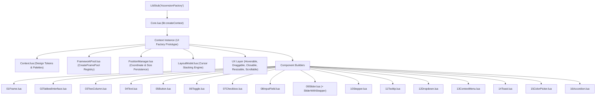
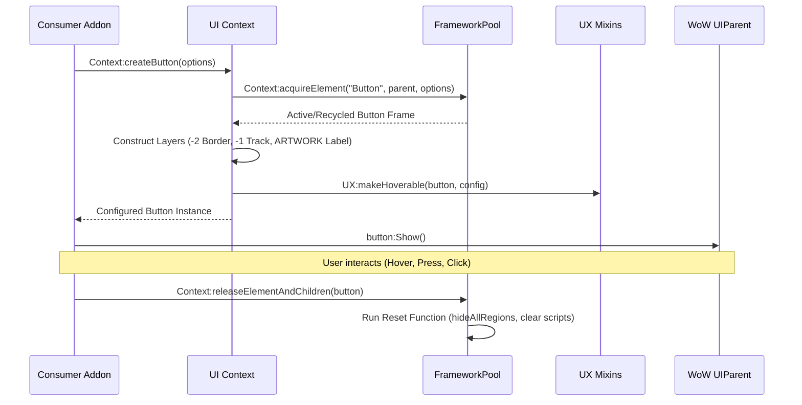

# AscensionFactory

An advanced, high-performance UI component library and layout framework for **World of Warcraft Retail (11.x / 12.x)** addons. Built with an **Obsidian & Cyberpunk Neon** design system, full memory recycling via Blizzard FramePools, procedural vector graphics, and an automatic cursor-based layout engine.

---

## Table of Contents

1. [Architecture Overview](#architecture-overview)
2. [Design System & Palette](#design-system--palette)
3. [Core Engine Subsystems](#core-engine-subsystems)
   - [Context Management](#context-management)
   - [Memory Pooling (FrameworkPool)](#memory-pooling-frameworkpool)
   - [Layout Model & Cursor Engine](#layout-model--cursor-engine)
   - [UX Interaction Modules](#ux-interaction-modules)
4. [Component API Reference](#component-api-reference)
   - [Frame & MainFrame](#mainframe)
   - [TabbedInterface](#tabbedinterface)
   - [TwoColumn](#twocolumn)
   - [Typography (Header, Label, Paragraph)](#typography)
   - [Buttons (Standard, Icon, Dialog, Group)](#buttons)
   - [Toggle Switch](#toggle-switch)
   - [Checkbox](#checkbox)
   - [InputField](#inputfield)
   - [Slider, Scrollbar & SliderWithStepper](#slider--scrollbar)
   - [Stepper](#stepper)
   - [Tooltip](#tooltip)
   - [Dropdown Select](#dropdown-select)
   - [Context Menu](#context-menu)
   - [Toast Notifications](#toast-notifications)
   - [Color Picker](#color-picker)
5. [Step-by-Step Recipes](#step-by-step-recipes)

---

## Architecture Overview

AscensionFactory is built upon an Object-Oriented metatable architecture wrapped inside LibStub. It separates design tokens, memory allocation, layout calculations, and interaction behaviors into distinct decoupled layers.

### System Architecture Diagram



### Component Lifecycle Flow



---

## Design System & Palette

All components consume standardized styling tokens from `uiContext.styles`. The default theme uses high-contrast Obsidian dark surfaces accented with vivid Neon lasers.

### Color Tokens

| Token | Hex / RGBA | Role / Usage |
| --- | --- | --- |
| `background` | `{0.008, 0.012, 0.020, 0.96}` | Deep Obsidian main window background |
| `panelBackground` | `{0.016, 0.024, 0.039, 0.60}` | Translucent container panel backdrop |
| `surfaceDark` | `{0.012, 0.020, 0.031, 0.90}` | Inner input and slider track background |
| `surfaceLight` | `{0.027, 0.039, 0.059, 0.90}` | Normal button and card surface |
| `surfaceHover` | `{0.055, 0.075, 0.110, 0.95}` | Hover state surface highlight |
| `border` | `{0.078, 0.102, 0.141, 1.00}` | Default structural frame border |
| `steelHighlight` | `{0.122, 0.153, 0.208, 1.00}` | Hover border highlight |
| `primary` | `{1.000, 0.380, 0.000, 1.00}` | Vivid Neon Orange accent & active border |
| `primaryHover` | `{1.000, 0.540, 0.050, 1.00}` | Laser Orange interactive hover state |
| `primaryActive` | `{0.700, 0.220, 0.000, 1.00}` | Deep Ember Orange pressed state |
| `neonRed` | `{1.000, 0.000, 0.150, 1.00}` | Close buttons and dangerous actions |
| `neonGreen` | `{0.000, 1.000, 0.400, 1.00}` | Confirm / Accept dialog actions |
| `white` | `{0.922, 0.973, 1.000, 1.00}` | Primary text labels and diamond thumbs |

---

## Core Engine Subsystems

### Context Management

[Core.lua](file:///Applications/World%20of%20Warcraft/_retail_/Interface/AddOns/AscensionFactory/Core/Core.lua)

Each consumer addon initializes an isolated Context:

```lua
local AscensionFactory = LibStub("AscensionFactory")
local uiContext = AscensionFactory:createContext()
```

Custom styles can be passed into `createContext(customStyles)` to override tokens per addon.

---

### Memory Pooling (FrameworkPool)

[FrameworkPool.lua](file:///Applications/World%20of%20Warcraft/_retail_/Interface/AddOns/AscensionFactory/Core/FrameworkPool.lua)

Prevents Lua garbage collection pauses by reusing Blizzard frames via `CreateFramePool`, `CreateTexturePool`, and `CreateFontStringPool`.

- `Context:acquireElement(elementType, parent, options)`: Returns a recycled or fresh widget instance (`"Frame"`, `"Button"`, `"StatusBar"`, `"CheckButton"`, `"EditBox"`, `"ScrollFrame"`, `"Slider"`, `"Model"`, `"Texture"`, `"FontString"`).
- `Context:releaseElement(elementType, element)`: Returns a single element to its pool.
- `Context:releaseElementAndChildren(element)`: Recursively resets and releases a frame along with all its child frames and regions.
- `Context:releaseAllElements()`: Resets and recycles all allocated pools.

---

### Layout Model & Cursor Engine

[LayoutModel.lua](file:///Applications/World%20of%20Warcraft/_retail_/Interface/AddOns/AscensionFactory/Core/LayoutModel.lua)

Provides dynamic cursor-based relative positioning. Developers stack widgets sequentially without hardcoding pixel coordinates.

```lua
local layout = uiContext:createLayoutModel(contentPanel)

layout:header("SectionHeader", "General Settings")
layout:addSpace(10)
layout:checkbox("AutoTargetCheckbox", "Enable Auto Target", getter, setter)
layout:button("ApplyButton", "Save Changes", nil, 120, 26, onClickCallback)
```

#### Layout Engine Features

- **Top-Down Anchoring Architecture**: Strict unidirectional anchoring hierarchy where children anchor downwards from parents (`currentParent` / `scrollChild`), eliminating WoW circular dependencies (`Cannot anchor to a region dependent on it`).
- **Sections (`beginSection(width)` / `endSection()`)**: Wraps widgets in an Obsidian bordered card with explicit deterministic height calculation, avoiding circular bottom anchors.
- **Adaptive Columns (`beginColumn(xOffsetOrOptions, width)` / `endColumn()` / `columnsFinalize(contentFrame, padding)`)**:
  - Balances multi-column layouts side-by-side in `"normal"` mode ($\ge 480$px).
  - Automatically stacks columns vertically at 100% width in `"compact"` mode ($< 480$px).
  - Supports proportional/percentage widths (`width <= 1.0`, e.g. `0.5` = 50% width).
  - Explicitly dimensions column and container heights (`SetHeight`) without circular bottom dependencies.
- **Responsive Breakpoint Engine & Auto-Scroll**:
  - `Context:createLayoutModel(parent, options)`: Automatically enables responsive capability unless `options.responsive == false` (default threshold: 480px).
  - `options.scrollable` / `options.autoScroll`: Automatically converts non-scrollable parent frames into a scrollable viewport via `UX:makeScrollable` and anchors elements to `scrollChild`.
  - Automatically resolves `parent.getContent and parent:getContent() or parent.scrollChild` for tabbed panels and scrollable containers.
  - `layout:enableResponsive(options)`: Enables container size observation on `OnSizeChanged` with 50ms debouncing, notifying mode changes (`"normal"` vs `"compact"`).
  - `layout:registerResponsiveElement(element, callback)`: Hooks element callbacks to react when breakpoints trigger.
  - `layout:getAvailableWidth(padding, element)`: Dynamically computes usable width inside active containers or element parent frames.
  - `layout:updateScrollRangeIfAvailable()`: Automatically reflows and recalculates scroll range when inside a scrollable viewport via `Scrollable:updateScrollRange()`.
  - **Smart Fluid Inheritance**: When responsiveness is active, all interactive controls (`button`, `toggle`, `checkbox`, `colorPicker`, `slider`, `sliderWithStepper`, `stepper`, `inputField`, `dropdown`) inherit `fluidWidth = true` / `flexRow = true` by default, expanding flexibly to available space unless given a fixed pixel width.
  - **Flex & Elastic Wrappers**: `layout:header`, `layout:label` support `elasticWidth = true` / `wordWrap = true`, and `layout:toggle`, `layout:checkbox`, `layout:colorPicker` support full-width `flexRow = true`.

---

### UX Interaction Modules

| Module | File | Method | Description |
| --- | --- | --- | --- |
| **Hoverable** | [Hoverable.lua](file:///Applications/World%20of%20Warcraft/_retail_/Interface/AddOns/AscensionFactory/UX/Hoverable.lua) | `UX:makeHoverable(element, config)` | Attaches unified `normal`, `hover`, `active`, `disabled` state management, custom color maps, and tooltips. |
| **Closable** | [Closable.lua](file:///Applications/World%20of%20Warcraft/_retail_/Interface/AddOns/AscensionFactory/UX/Closable.lua) | `UX:makeClosableWithEscape(frame, config)` | Binds Escape key to close the window, with optional pool release via `config.releaseOnHide`. |
| **PositionManager (Core)** | [PositionManager.lua](file:///Applications/World%20of%20Warcraft/_retail_/Interface/AddOns/AscensionFactory/Core/PositionManager.lua) | `PositionManager:initPositionStorage(key, defaults)` | Manages coordinate and dimension persistence (`_G.AscensionUIPositions`) for any frame. |
| **Draggable** | [Draggable.lua](file:///Applications/World%20of%20Warcraft/_retail_/Interface/AddOns/AscensionFactory/UX/Draggable.lua) | `UX:makeMovable(frame, config)` | Enables left-click dragging (requires explicit `config.savePosition` boolean) and delegates persistence to `PositionManager`. |
| **Resizable** | [Resizable.lua](file:///Applications/World%20of%20Warcraft/_retail_/Interface/AddOns/AscensionFactory/UX/Resizable.lua) | `UX:makeResizable(frame, options)` | Adds a bottom-right metallic corner bracket with `SetResizeBounds` constraints and callbacks. |
| **Scrollable** | [Scrollable.lua](file:///Applications/World%20of%20Warcraft/_retail_/Interface/AddOns/AscensionFactory/UX/Scrollable.lua) | `UX:makeScrollable(container, options)` | Transforms any container into a scrollable viewport with an integrated vertical `09Slider` scrollbar and recursive descendant height calculation. |

---

## Component API Reference

Complete technical reference and audit index for all UI constructors and UX capabilities in `Components/`, `UX/`, `Core/PositionManager.lua`, and `Core/LayoutModel.lua`. Every configuration parameter is audited below with explicit data types, requirements (**Obligatorio** vs **Opcional**), and default values. Also available as a standalone reference in [`Components/README.md`](file:///Applications/World%20of%20Warcraft/_retail_/Interface/AddOns/AscensionFactory/Components/README.md).

### Quick Navigation Table

| File | Constructor | Description | Composite Sub-Elements | Requisitos Clave |
| :--- | :--- | :--- | :--- | :--- |
| [`01Frame.lua`](file:///Applications/World%20of%20Warcraft/_retail_/Interface/AddOns/AscensionFactory/Components/01Frame.lua) | `Context:createFrame(options)` | Versatile Obsidian Cyberpunk container frame | Container `Frame`, Border `Texture`, Background `Texture` | `name`, `parent`, `width`, `height` (**Obligatorios**), `savePosition` (**Obligatorio** si `movable=true`), `saveSize` (**Obligatorio** si `resizable=true`), `clamped=true` |
| [`01Frame.lua`](file:///Applications/World%20of%20Warcraft/_retail_/Interface/AddOns/AscensionFactory/Components/01Frame.lua) | `Context:createMainFrame(options)` | Top-level application window | Container `Frame`, Border `Texture`, Background `Texture`, `IconButton` (Close) | `name`, `parent`, `width`, `height`, `minWidth`, `minHeight`, `savePosition`, `saveSize` (**Obligatorios**), `strata="HIGH"`, `movable=true`, `closableWithEscape=true`, `showCloseButton=true`, `resizable=true` |
| [`02TabbedInterface.lua`](file:///Applications/World%20of%20Warcraft/_retail_/Interface/AddOns/AscensionFactory/Components/02TabbedInterface.lua) | `Context:createTabbedInterface(options)` | Responsive sidebar navigation with auto-collapsing panels and auto-scroll | Collapsible Sidebar `Frame`, `LayoutModel`, `Button[]` (Tabs), Accent `Texture[]`, `Frame[]` (Panels with `UX:makeScrollable`) | `name`, `parent`, `startY`, `tabs`, `sidebarWidth` (**Obligatorios**), `initialIndex=1`, `collapsibleSidebar=true`, `collapseThreshold=550`, `autoScroll=true` |
| [`03TwoColumn.lua`](file:///Applications/World%20of%20Warcraft/_retail_/Interface/AddOns/AscensionFactory/Components/03TwoColumn.lua) | `Context:createTwoColumns(options)` | Responsive split column layout with auto-stacking below breakpoint | Left `Frame`, Right `Frame`, Optional Background `Texture` | `name`, `parent` (**Obligatorios**), `stackThreshold=480`, `responsive=true`, `gap=10` |
| [`03ColumnGroup.lua`](file:///Applications/World%20of%20Warcraft/_retail_/Interface/AddOns/AscensionFactory/Components/03ColumnGroup.lua) | `Context:createColumnGroup(options)` / `layout:row(options)` | Autonomous N-column responsive structural container with trifasic height pipeline | Group `Frame`, Column `Frame[]`, Isolated `LayoutModel[]` | `parent` (**Obligatorio**), `gap=10` (Context default), `threshold=480`, `fluidWidth=true` |
| [`04Text.lua`](file:///Applications/World%20of%20Warcraft/_retail_/Interface/AddOns/AscensionFactory/Components/04Text.lua) | `Context:createHeader(options)` | Glowing section title with optional elastic word-wrap | `FontString` | `name`, `parent`, `text` (**Obligatorios**), `fontSize=24`, `justifyH="LEFT"`, `wordWrap=true`, `elasticWidth=true` |
| [`04Text.lua`](file:///Applications/World%20of%20Warcraft/_retail_/Interface/AddOns/AscensionFactory/Components/04Text.lua) | `Context:createLabel(options)` | Single-line form label with optional elastic word-wrap | `FontString` | `name`, `parent`, `text` (**Obligatorios**), `fontSize=18`, `justifyH="LEFT"`, `wordWrap=true`, `elasticWidth=true` |
| [`04Text.lua`](file:///Applications/World%20of%20Warcraft/_retail_/Interface/AddOns/AscensionFactory/Components/04Text.lua) | `Context:createParagraph(options)` | Multi-line wrapped text body | `FontString` | `name`, `parent`, `text` (**Obligatorios**), `fontSize=12`, `wordWrap=true`, `elasticWidth=true` |
| [`05Button.lua`](file:///Applications/World%20of%20Warcraft/_retail_/Interface/AddOns/AscensionFactory/Components/05Button.lua) | `Context:createButton(options)` | Interactive styled push button | `Button`, Border `Texture`, Track `Texture`, `FontString` | `name`, `parent`, `height`, `tooltip` (**Obligatorios**), `width` (o `fluidWidth=true`), `clickTypes={"AnyUp"}` |
| [`05Button.lua`](file:///Applications/World%20of%20Warcraft/_retail_/Interface/AddOns/AscensionFactory/Components/05Button.lua) | `Context:createIconButton(options)` | Square geometric vector icon button with rotation support | `Button`, Geometric vector `Texture[]` (`close`, `plus`, `minus`, `minimize`, `maximize`, `arrowdown`, `arrowleft`, `arrowright`, `arrowup`) | `name`, `parent`, `iconType`, `size`, `tooltip` (**Obligatorios**) |
| [`05Button.lua`](file:///Applications/World%20of%20Warcraft/_retail_/Interface/AddOns/AscensionFactory/Components/05Button.lua) | `Context:createDialogButton(options)` | Semantic action button (`accept`/`cancel`/`neutral`) | `Button`, Border `Texture`, Track `Texture`, `FontString` | `name`, `parent`, `variant`, `tooltip` (**Obligatorios**), `width=90` auto-expand, `fluidWidth=false` |
| [`05Button.lua`](file:///Applications/World%20of%20Warcraft/_retail_/Interface/AddOns/AscensionFactory/Components/05Button.lua) | `Context:createDialogButtonGroup(options)` | Responsive dialog action button row with auto-stacking below breakpoint | Container `Frame`, `DialogButton[]` | `name`, `parent`, `buttons` (**Obligatorios**), `stackThreshold=400`, `gap=8`, `buttonHeight=26` |
| [`06Toggle.lua`](file:///Applications/World%20of%20Warcraft/_retail_/Interface/AddOns/AscensionFactory/Components/06Toggle.lua) | `Context:createToggle(options)` | Animated binary switch (on/off) with flex row mode | `Button`, Border `Texture`, Track `Texture`, Sliding Thumb `Texture`, Optional Label `FontString` | `name`, `parent`, `tooltip` (**Obligatorios**), `width=52`, `height=24`, `padding=2`, `flexRow=false` |
| [`07Checkbox.lua`](file:///Applications/World%20of%20Warcraft/_retail_/Interface/AddOns/AscensionFactory/Components/07Checkbox.lua) | `Context:createCheckbox(options)` | Checkbox row with vector checkmark and flex row mode | Row `Button`, Box Border `Texture`, Box Track `Texture`, Vector Check Leg `Texture[2]`, Label `FontString` | `name`, `parent`, `tooltip` (**Obligatorios**), `checked=false`, `boxSize=25`, `flexRow=false` |
| [`08InputField.lua`](file:///Applications/World%20of%20Warcraft/_retail_/Interface/AddOns/AscensionFactory/Components/08InputField.lua) | `Context:createInputField(options)` | Single/Multi-line text input & scroll area with fluid width support | Container `Frame`, Border `Texture`, Track `Texture`, `ScrollFrame` (multi-line), `EditBox`, Placeholder `FontString`, `IconButton` (Clear), `Slider` (Scrollbar) | `name`, `parent`, `height`, `tooltip` (**Obligatorios**), `width` (**Obligatorio** salvo `fluidWidth=true`), `multiLine=false` |
| [`09Slider.lua`](file:///Applications/World%20of%20Warcraft/_retail_/Interface/AddOns/AscensionFactory/Components/09Slider.lua) | `Context:createSlider(options)` | Horizontal/Vertical slider & meter with fluid width support | `Frame`, Border `Texture`, Track `Texture`, Fill `Texture`, Diamond/Capsule/Bar Thumb `Button` | `name`, `parent`, `orientation`, `minValue`, `maxValue`, `step`, `tooltip` (**Obligatorios**), `length` (**Obligatorio** salvo `fluidWidth=true`) |
| [`09Slider.lua`](file:///Applications/World%20of%20Warcraft/_retail_/Interface/AddOns/AscensionFactory/Components/09Slider.lua) | `Context:createSliderWithStepper(options)` | Composite horizontal slider with integrated synchronized stepper below | Horizontal `Slider` (`09Slider`), Integrated `Stepper` (`10Stepper`) | `name`, `parent`, `minValue`, `maxValue`, `step`, `tooltip` (**Obligatorios**), `length` (**Obligatorio** salvo `fluidWidth=true`), `stepperGap=4`, `stepperHeight=24` |
| [`10Stepper.lua`](file:///Applications/World%20of%20Warcraft/_retail_/Interface/AddOns/AscensionFactory/Components/10Stepper.lua) | `Context:createStepper(options)` | Joined numeric stepper with repeat ticker and fluid width support | Container `Frame`, Minus `IconButton`, Middle `InputField`, Plus `IconButton` | `name`, `parent`, `minValue`, `maxValue`, `step`, `tooltip` (**Obligatorios**), `width` (**Obligatorio** salvo `fluidWidth=true`), `height=24` |
| [`11Tooltip.lua`](file:///Applications/World%20of%20Warcraft/_retail_/Interface/AddOns/AscensionFactory/Components/11Tooltip.lua) | `Context:createTooltip(options)` / `getTooltip()` | Obsidian Cyberpunk styled tooltip | Container `Frame` (`01Frame`), Title `FontString`, Description `FontString` | `name` (**Obligatorio**), `parent=_G.UIParent`, `maxWidth=1/3 pantalla`, `maxHeight=9/10 pantalla`, `padding=12` |
| [`12Dropdown.lua`](file:///Applications/World%20of%20Warcraft/_retail_/Interface/AddOns/AscensionFactory/Components/12Dropdown.lua) | `Context:createDropdown(options)` | Dropdown select with scrollable list and fluid width support | Trigger `Button`, Down Arrow `IconButton`, List `Frame` (`01Frame`), `ScrollFrame` (`09Slider`) | `name`, `parent`, `tooltip` (**Obligatorios**), `width` (**Obligatorio** salvo `fluidWidth=true`), `options={}`, `height=26`, `fluidWidth=false` |
| [`13ContextMenu.lua`](file:///Applications/World%20of%20Warcraft/_retail_/Interface/AddOns/AscensionFactory/Components/13ContextMenu.lua) | `Context:createContextMenu(options)` / `UX:showContextMenu` | Right-click popup context menu | Menu `Frame` (`01Frame`), Item `Button[]` (`05Button`), Separator `Texture[]` | `name`, `parent`, `items` (**Obligatorios**), `minWidth=22`, `itemHeight=22` |
| [`14Toast.lua`](file:///Applications/World%20of%20Warcraft/_retail_/Interface/AddOns/AscensionFactory/Components/14Toast.lua) | `Context:showToast(options)` / `createToast` | Cyberpunk HUD notification toast & queue | Toast `Frame` (`01Frame`), Title `FontString`, Message `FontString`, `IconButton` (Close), Icon `Frame` (Vector/Atlas), Countdown `StatusBar` | `parent=toastManager.frame`, `name=Auto-generado`, `minWidth=50`, `maxWidth=200`, `minHeight=35`, `duration=4` |
| [`15ColorPicker.lua`](file:///Applications/World%20of%20Warcraft/_retail_/Interface/AddOns/AscensionFactory/Components/15ColorPicker.lua) | `Context:createColorPicker(options)` / `openColorPicker` | Clean row with 24x24 square color swatch button & Cyberpunk RGBA modal picker | Row `Button`, 24x24 Swatch `Button`, Label `FontString`, Modal `Frame`, Hex `InputField`, RGBA `Slider[]`, History `Button[]` | `name`, `parent`, `tooltip` (**Obligatorios**), `swatchSize=24`, `color={1,1,1,1}`, `hasAlpha=true`, `flexRow=false` |
| [`16Accordion.lua`](file:///Applications/World%20of%20Warcraft/_retail_/Interface/AddOns/AscensionFactory/Components/16Accordion.lua) | `Context:createAccordion(options)` / `layout:accordion` | Expandable card container with header button, rotating chevron arrow & internal LayoutModel | Card `Frame`, Header `Button`, Arrow `IconButton`, Title `FontString`, Subtitle `FontString`, Content `Frame`, Sub-`LayoutModel` | `name`, `parent`, `title` (**Obligatorios**), `expanded=false`, `fluidWidth=true`, `rightOffset=-10`, `headerHeight=28`, `contentPadding=10` |
| [`Core/PositionManager.lua`](file:///Applications/World%20of%20Warcraft/_retail_/Interface/AddOns/AscensionFactory/Core/PositionManager.lua) | `PositionManager:initPositionStorage` / `updatePositionFromFrame` / `applySavedPosition` | Global coordinate & dimension persistence engine (`_G.AscensionUIPositions`) | `_G.AscensionUIPositions[moduleKey]` | `moduleKey` (**Obligatorio** en `initPositionStorage`) |
| [`UX/Draggable.lua`](file:///Applications/World%20of%20Warcraft/_retail_/Interface/AddOns/AscensionFactory/UX/Draggable.lua) | `UX:makeMovable(frame, config)` | Frame mouse drag movement (delegates persistence to `PositionManager`) | `frame` drag scripts | `frame`, `config.savePosition` (`boolean` **Obligatorio**) |
| [`UX/Scrollable.lua`](file:///Applications/World%20of%20Warcraft/_retail_/Interface/AddOns/AscensionFactory/UX/Scrollable.lua) | `UX:makeScrollable(container, options)` | UX scroll viewport capability | `ScrollFrame`, Content `Frame`, Vertical `Slider` (`09Slider`) | `container` (**Obligatorio**), `scrollBarWidth=12`, `step=30`, `thumbShape="capsule"` |
| [`UX/Resizable.lua`](file:///Applications/World%20of%20Warcraft/_retail_/Interface/AddOns/AscensionFactory/UX/Resizable.lua) | `UX:makeResizable(frame, options)` | UX corner bracket resize capability (delegates size persistence to `PositionManager`) | Corner Button, Bracket `Texture[2]` (`WHITE8X8`), Metallic states | `frame`, `options.saveSize` (`boolean` **Obligatorio**), `gripSize=24`, `gripThickness=8` |
| [`UX/Responsive.lua`](file:///Applications/World%20of%20Warcraft/_retail_/Interface/AddOns/AscensionFactory/UX/Responsive.lua) | `UX:makeResponsive(frame, options)` | Independent debounced breakpoint observer (`normal` vs `compact`) | `responsiveCoordinator` attached to frame | `frame` (**Obligatorio**), `threshold=480`, `debounce=0.05` |
| [`Core/LayoutModel.lua`](file:///Applications/World%20of%20Warcraft/_retail_/Interface/AddOns/AscensionFactory/Core/LayoutModel.lua) | `Context:createLayoutModel(parent)` | Pure relative anchoring cursor & trifasic sizing engine | Dynamic element list, `accumulatedHeight`, `onChildResized` | `parent` (**Obligatorio**), `verticalGap=10` (Context default), `add(element, options)` |
| [`Core/LayoutBuilder.lua`](file:///Applications/World%20of%20Warcraft/_retail_/Interface/AddOns/AscensionFactory/Core/LayoutBuilder.lua) | `LayoutBuilder:new(ctx, layout)` / `Context` auto-anchor | Fluent form wrappers, atomic `row()`, & centralized `{ layout = myLayout }` interceptor | Wrappers delegating to `Context:create*` | `layout` (**Obligatorio** en auto-anclaje), `row(options)` |

---

### Component Detailed Specifications

### 1. `01Frame.lua`

#### `Context:createFrame(options)`
Versatile container frame styled with Obsidian Cyberpunk metallic borders and background layers.

- **Composite Elements**:
  - `frame` (`Frame`): Container frame in the WoW hierarchy.
  - `frame.border` (`Texture`): Outer border texture on layer `BACKGROUND` (-2).
  - `frame.background` (`Texture`): Inner surface fill on layer `BACKGROUND` (-1).
  - `frame.closeButton` (`Button` / `IconButton`): Top-right close button (optional).

##### Tabla de Opciones de Configuración (`options`)
| Parámetro | Tipo | Requisito | Valor por Defecto | Descripción |
| :--- | :--- | :--- | :--- | :--- |
| `name` | `string` | **Obligatorio** | *Ninguno (Error si falta)* | Identificador global registrado en `_G[name]`. |
| `parent` | `Frame` | **Obligatorio** | *Ninguno (Requerido)* | Frame padre en la jerarquía de interfaz de WoW. |
| `width` | `number` | **Obligatorio** | *Ninguno (Requerido)* | Ancho del frame en píxeles. |
| `height` | `number` | **Obligatorio** | *Ninguno (Requerido)* | Alto del frame en píxeles. |
| `point` / `anchorPoint` | `string` | **Opcional** | `options.anchor or "CENTER"` | Punto de anclaje relativo (`"CENTER"`, `"TOPLEFT"`, etc.). |
| `relativeTo` | `Frame` | **Opcional** | `parent` | Frame o UI element de referencia para el anclaje. |
| `relativePoint` | `string` | **Opcional** | `options.point or "CENTER"` | Punto de anclaje en el objeto relativo. |
 | `xOffset` | `number` | **Opcional** | `0` | Desplazamiento horizontal en píxeles. |
| `yOffset` | `number` | **Opcional** | `0` | Desplazamiento vertical en píxeles. |
| `strata` | `string` | **Opcional** | `parent:GetFrameStrata() or "HIGH"` | Nivel de strata (`"BACKGROUND"`, `"MEDIUM"`, `"HIGH"`, `"DIALOG"`, etc.). |
| `frameLevel` | `number` | **Opcional** | `parent:GetFrameLevel() + 1` | Z-index relativo dentro de la strata. |
| `clamped` | `boolean` | **Opcional** | `true` | Restringe el frame para que no pueda salir de la pantalla visible (`SetClampedToScreen`). |
| `showBorder` | `boolean` | **Opcional** | `true` | Si dibuja la textura perimetral de borde exterior. |
| `borderColor` | `table` RGBA | **Opcional** | `styles.colors.border` | Color RGBA del borde `{r, g, b, a}`. |
| `borderInset` | `number` | **Opcional** | `1` | Grosor / inset del borde perimetral en píxeles. |
| `showBackground` | `boolean` | **Opcional** | `true` | Si dibuja la textura interna de fondo. |
| `backgroundColor` | `table` RGBA | **Opcional** | `styles.colors.background` | Color RGBA de la superficie de fondo `{r, g, b, a}`. |
| `showCloseButton` | `boolean` | **Opcional** | `false` | Genera un botón 'X' de cierre en la esquina superior derecha. |
| `closeButtonSize` | `number` | **Opcional** | `24` | Dimensiones en píxeles del botón de cierre. |
| `closeButtonXOffset` | `number` | **Opcional** | `-8` | Desplazamiento horizontal del botón de cierre respecto a TOPRIGHT. |
| `closeButtonYOffset` | `number` | **Opcional** | `-8` | Desplazamiento vertical del botón de cierre respecto a TOPRIGHT. |
| `onClose` | `function(frame)` | **Opcional** | `nil` | Callback ejecutado al hacer click en el botón de cierre. |
| `movable` | `boolean` | **Opcional** | `false` | Permite mover la ventana arrastrándola con el cursor (`UX:makeMovable`). |
| `savePosition` | `boolean` | **Obligatorio si `movable=true`** | *Ninguno (Requerido si `movable=true`)* | Define explícitamente (`true` o `false`) si el frame persiste sus coordenadas en `Core/PositionManager.lua`. |
| `closableWithEscape` | `boolean` | **Opcional** | `false` | Registra el frame en `UISpecialFrames` para permitir cerrarlo con Escape. |
| `resizable` | `boolean` | **Opcional** | `false` | Habilita la manija de redimensión en la esquina inferior derecha (`UX:makeResizable`). |
| `saveSize` | `boolean` | **Obligatorio si `resizable=true`** | *Ninguno (Requerido si `resizable=true`)* | Define explícitamente (`true` o `false`) si el frame persiste su ancho y alto (`width`, `height`) en `Core/PositionManager.lua`. |
| `minWidth` | `number` | **Opcional** | `0` | Ancho mínimo permitido al redimensionar. |
| `minHeight` | `number` | **Opcional** | `0` | Alto mínimo permitido al redimensionar. |
| `maxWidth` | `number` | **Opcional** | `0` | Ancho máximo permitido al redimensionar (`0` = sin límite). |
| `maxHeight` | `number` | **Opcional** | `0` | Alto máximo permitido al redimensionar (`0` = sin límite). |
| `onResizeStop` | `function(frame, width, height)` | **Opcional** | `nil` | Callback ejecutado al soltar el botón de redimensión. |
| `onSizeChanged` | `function(frame, width, height)` | **Opcional** | `nil` | Callback ejecutado dinámicamente durante el cambio de tamaño. |

- **Instance Methods / Properties**:
  - API nativa de WoW `Frame` (`Show()`, `Hide()`, `SetPoint()`, `SetSize()`, etc.).
  - `frame.globalName` (`string`).

---

#### `Context:createMainFrame(options)`
Top-level application window container styled with Obsidian Cyberpunk metallic borders and background. Configures window dragging and Escape-to-close by default.

- **Composite Elements**:
  - `frame` (`Frame`): Top-level window attached to `UIParent`.
  - `frame.border` (`Texture`): Outer border texture on layer `BACKGROUND` (-2).
  - `frame.background` (`Texture`): Inner surface fill on layer `BACKGROUND` (-1).
  - `frame.closeButton` (`Button` / `IconButton`): Top-right close button.

##### Tabla de Opciones de Configuración (`options`)
| Parámetro | Tipo | Requisito | Valor por Defecto | Descripción |
| :--- | :--- | :--- | :--- | :--- |
| `name` | `string` | **Obligatorio** | *Ninguno (Error si falta)* | Identificador global único para la ventana (`_G[name]`). |
| `parent` | `Frame` | **Obligatorio** | *Ninguno (Requerido)* | Frame padre en la jerarquía. |
| `width` | `number` | **Obligatorio** | *Ninguno (Requerido)* | Ancho total de la ventana principal en píxeles. |
| `height` | `number` | **Obligatorio** | *Ninguno (Requerido)* | Alto total de la ventana principal en píxeles. |
| `anchor` / `point` | `string` | **Opcional** | `"CENTER"` | Posición inicial de anclaje en pantalla. |
| `relativePoint` | `string` | **Opcional** | `"CENTER"` | Punto de anclaje en el objeto relativo. |
| `xOffset` | `number` | **Opcional** | `0` | Desplazamiento horizontal inicial en píxeles. |
| `yOffset` | `number` | **Opcional** | `0` | Desplazamiento vertical inicial en píxeles. |
| `strata` | `string` | **Opcional** | `"HIGH"` | Strata de la ventana principal (`"DIALOG"`, `"HIGH"`, etc.). |
| `clamped` | `boolean` | **Opcional** | `true` | Impide arrastrar la ventana fuera de la pantalla visible. |
| `movable` | `boolean` | **Opcional** | `true` | Habilita arrastre con el ratón por toda la superficie de la ventana. |
| `savePosition` | `boolean` | **Obligatorio\*** | *Ninguno (Requerido si `movable=true`)* | Define explícitamente (`true` o `false`) si la ventana principal persiste su posición en `Core/PositionManager.lua`. |
| `closableWithEscape` | `boolean` | **Opcional** | `true` | Registra la ventana en `UISpecialFrames` para cerrarse con Esc. |
| `showCloseButton` | `boolean` | **Opcional** | `true` | Muestra el botón de cierre 'X' en la esquina superior derecha. |
| `closeButtonSize` | `number` | **Opcional** | `24` | Tamaño en píxeles del botón de cierre. |
| `closeButtonXOffset` | `number` | **Opcional** | `-8` | Offset X del botón de cierre. |
| `closeButtonYOffset` | `number` | **Opcional** | `-8` | Offset Y del botón de cierre. |
| `onClose` | `function(frame)` | **Opcional** | `nil` | Callback ejecutado tras cerrar la ventana. |
| `borderInset` | `number` | **Opcional** | `2` | Grosor / inset del borde exterior en píxeles. |
| `resizable` | `boolean` | **Opcional** | `true` | Habilita la manija de redimensión metálica en la esquina inferior derecha. |
| `saveSize` | `boolean` | **Obligatorio\*** | *Ninguno (Requerido si `resizable=true`)* | Define explícitamente (`true` o `false`) si la ventana principal persiste su ancho y alto en `Core/PositionManager.lua`. |
| `minWidth` | `number` | **Obligatorio** | *Ninguno (Requerido)* | Ancho mínimo permitido al redimensionar. |
| `minHeight` | `number` | **Obligatorio** | *Ninguno (Requerido)* | Alto mínimo permitido al redimensionar. |
| `maxWidth` | `number` | **Opcional** | `0` | Ancho máximo permitido al redimensionar (`0` = sin límite). |
| `maxHeight` | `number` | **Opcional** | `0` | Alto máximo permitido al redimensionar (`0` = sin límite). |
| `onResizeStop` | `function(frame, width, height)` | **Opcional** | `nil` | Callback ejecutado al soltar el botón de redimensión. |
| `onSizeChanged` | `function(frame, width, height)` | **Opcional** | `nil` | Callback ejecutado dinámicamente durante el cambio de tamaño. |

- **Instance Methods / Properties**:
  - API nativa de WoW `Frame` (`Show()`, `Hide()`, `SetPoint()`, `SetSize()`, etc.).
  - `frame.globalName` (`string`).

---

### 2. `02TabbedInterface.lua`

#### `Context:createTabbedInterface(options)`
Constructs a vertical navigation sidebar and synchronized content panels with active indicator accents, responsive auto-collapsing sidebar to compact icon indicators, manual toggle arrow button, and integrated auto-scroll viewport per panel via `UX:makeScrollable`.

- **Composite Elements**:
  - `sidebar` (`Frame`): Navigation container (width: `sidebarWidth` [160px] or `collapsedWidth` [40px]).
  - `sidebar.toggleButton` (`IconButton`): Top-right arrow button toggling collapse/expand with smooth rotation.
  - `tabs` (`Button[]`): Array of tab button frames managed by `LayoutModel`.
  - `tab.tabLabel` (`FontString`): Standard text title, visible in expanded mode.
  - `tab.compactIndicator` (`FontString`): Centered 1-2 letter uppercase monogram, visible in collapsed mode.
  - `tab.accent` (`Texture`): 8px left indicator bar colored in `primary` / `primaryActive`.
  - `panels` (`Frame[]`): Array of content panels matching tab order.
  - `panel.scrollFrame` (`ScrollFrame`): Scrollable viewport attached when `autoScroll = true`.
  - `panel.scrollChild` (`Frame`): Content container for placing user elements when `autoScroll = true`.
  - `panel.scrollbar` (`Slider`): Vertical capsule slider attached when `autoScroll = true`.

##### Tabla de Opciones de Configuración (`options`)
| Parámetro | Tipo | Requisito | Valor por Defecto | Descripción |
| :--- | :--- | :--- | :--- | :--- |
| `name` | `string` | **Obligatorio** | *Ninguno (Requerido)* | Identificador global en `_G[name]`. |
| `parent` | `Frame` | **Obligatorio** | *Ninguno (Requerido)* | Frame contenedor sobre el que se anclan sidebar y paneles. |
| `startY` | `number` | **Obligatorio** | *Ninguno (Requerido)* | Offset vertical (negativo, e.g. `-30`) para ubicar la parte superior del sidebar. |
| `tabs` | `string[]` | **Obligatorio** | *Ninguno (Requerido)* | Array secuencial con títulos de pestañas (`{"General", "Audio", ...}`). |
| `initialIndex` | `number` | **Opcional** | `1` | Índice (1-based) de la pestaña que se activa por defecto al iniciar. |
| `sidebarWidth` | `number` | **Obligatorio** | *Ninguno (Requerido)* | Ancho del sidebar expandido en píxeles. |
| `collapsedWidth` | `number` | **Opcional** | `40` | Ancho del sidebar colapsado (compact mode) en píxeles. |
| `collapseThreshold` | `number` | **Opcional** | `550` | Ancho del frame padre por debajo del cual el sidebar se colapsa automáticamente. |
| `collapsibleSidebar` | `boolean` | **Opcional** | `true` | Habilita botón de toggle superior y auto-colapso responsivo. |
| `autoScroll` | `boolean` | **Opcional** | `true` | Integra automáticamente un viewport desplazable (`UX:makeScrollable`) en cada panel. |
| `contentPaddingLeft` | `number` | **Opcional** | `4` | Margen horizontal izquierdo en píxeles aplicado al viewport de cada panel desplazable. |
| `scrollStep` | `number` | **Opcional** | `30` | Paso de desplazamiento del scroll en píxeles por giro de rueda del ratón. |
| `onSidebarToggle` | `function(sidebar, isCollapsed)` | **Opcional** | `nil` | Callback ejecutado cuando el sidebar se expande o colapsa. |
| `onTabSelected` | `function(index, tab, panel)` | **Opcional** | `nil` | Callback ejecutado cuando el usuario cambia de pestaña. |

- **Return Value**:
  - `table`:
    - `sidebar` (`Frame`): Frame contenedor del menú lateral.
    - `tabs` (`Button[]`): Array de botones de navegación.
    - `panels` (`Frame[]`): Array de paneles de contenido (con `panel.scrollChild` si `autoScroll=true`).
    - `toggleButton` (`IconButton`): Botón flecha de colapso/expansión.
    - `collapseSidebar()` (`function`): Colapsa el sidebar a modo compacto.
    - `expandSidebar()` (`function`): Expande el sidebar a modo normal.
    - `toggleSidebar()` (`function`): Alterna el estado de colapso.
    - `isCollapsed()` (`function(): boolean`): Devuelve `true` si el sidebar está colapsado.
    - `selectTab(index)` (`function`): Cambia programáticamente la pestaña activa.
    - `getActiveTab()` (`function(): number`): Devuelve el índice de la pestaña activa.

---

### 3. `03TwoColumn.lua`

#### `Context:createTwoColumns(options)`
Splits parent width into two container columns with a configurable center gap. Features automatic responsive stacking: maintains 50%/50% side-by-side mode in wide layouts, and automatically transitions to 100% full-width vertical stacked layout when parent width falls below `stackThreshold` (default 480px).

- **Composite Elements**:
  - `leftColumn` (`Frame`): Top/left container frame.
  - `rightColumn` (`Frame`): Bottom/right container frame.
  - Optional `background` (`Texture`) on each column.

##### Tabla de Opciones de Configuración (`options`)
| Parámetro | Tipo | Requisito | Valor por Defecto | Descripción |
| :--- | :--- | :--- | :--- | :--- |
| `name` | `string` | **Obligatorio** | *Ninguno (Requerido)* | Prefijo para nombres globales (`_G[name.."Left"]`, `_G[name.."Right"]`). |
| `parent` | `Frame` | **Obligatorio** | *Ninguno (Requerido)* | Frame padre en el cual se divide el espacio. |
| `yOffset` | `number` | **Opcional** | `0` | Offset vertical desde la parte superior del padre en píxeles. |
| `height` | `number` | **Opcional** | `nil` *(Ancla al BOTTOM del padre)* | Altura fija de las columnas en píxeles. Si no se pasa, llena hasta abajo en modo horizontal. |
| `gap` | `number` | **Opcional** | `10` | Separación en píxeles entre ambas columnas. |
| `stackThreshold` / `threshold` | `number` | **Opcional** | `480` | Ancho en píxeles por debajo del cual las columnas se apilan verticalmente (100% ancho). |
| `responsive` | `boolean` | **Opcional** | `true` | Si se suscribe automáticamente a `OnSizeChanged` del padre para auto-apilarse. |
| `stackedColumnHeight` | `number` | **Opcional** | `200` | Altura en píxeles de cada columna al colapsar a modo apilado si `height` es `nil`. |
| `backgroundColor` | `table` RGBA | **Opcional** | `nil` *(Transparente {0,0,0,0})* | Color de fondo aplicado a ambas columnas. |
| `leftBackgroundColor` | `table` RGBA | **Opcional** | `options.backgroundColor` | Color de fondo específico para la columna izquierda. |
| `rightBackgroundColor` | `table` RGBA | **Opcional** | `options.backgroundColor` | Color de fondo específico para la columna derecha. |
| `onLayoutChange` | `function(left, right, mode, width)` | **Opcional** | `nil` | Callback ejecutado cuando el modo cambia entre `"horizontal"` y `"stacked"`. |

- **Return Value**:
  - `leftColumn, rightColumn` (`Frame, Frame`).
- **Attached Column Methods & Properties**:
  - `column.mode`: `"horizontal"` o `"stacked"`.
  - `column.isStacked()` (`function(): boolean`): Devuelve `true` si las columnas están apiladas verticalmente.
  - `column.updateLayout(width)` (`function`): Fuerza una recalculación del layout para un ancho dado.
  - `column.otherColumn`: Referencia a la columna complementaria.
  - `column.parentFrame`: Referencia al contenedor padre.

---

### 4. `04Text.lua`

#### `Context:createHeader(options)`
Creates glowing section title header text with neon orange cyberpunk accent.

- **Composite Elements**: `FontString`.

##### Tabla de Opciones de Configuración (`options`)
| Parámetro | Tipo | Requisito | Valor por Defecto | Descripción |
| :--- | :--- | :--- | :--- | :--- |
| `name` | `string` | **Obligatorio** | *Ninguno (Error si falta)* | Identificador global en `_G[name]`. |
| `parent` | `Frame` | **Obligatorio** | *Ninguno (Requerido)* | Frame padre donde se crea el FontString. |
| `text` | `string` | **Obligatorio** | *Ninguno (Requerido)* | Contenido del texto del título. |
| `fontSize` | `number` | **Opcional** | `24` | Tamaño de la fuente en píxeles. |
| `fontFamily` | `string` | **Opcional** | `"fonts/frizqt___cyr.ttf"` | Ruta al archivo de fuente tipográfica. |
| `shadowColor` | `table` RGBA | **Opcional** | `styles.colors.surfaceDark` | Color de sombra del texto (offset fijo 2, -2). |
| `wordWrap` | `boolean` | **Opcional** | `true` | Si se permite o restringe el ajuste de línea automático. |
| `elasticWidth` | `boolean` | **Opcional** | `true` | Ancla automáticamente el extremo derecho al borde del padre con `wordWrap=true` preservando el tamaño tipográfico. |
| `justifyH` | `string` | **Opcional** | `"LEFT"` | Alineación horizontal (`"LEFT"`, `"CENTER"`, `"RIGHT"`). |
| `width` | `number` | **Opcional** | `nil` | Ancho explícito en píxeles para delimitar el texto. |
| `rightOffset` | `number` | **Opcional** | `nil` | Ancla el extremo derecho al borde del padre con este offset. |
| `spaceBelow` | `number` | **Opcional** | `0` | Espacio en píxeles añadido debajo al calcular `nextY`. |
| `point` / `anchorPoint` | `string` | **Opcional** | `"TOPLEFT"` | Punto de anclaje relativo. |
| `relativeTo` | `Frame` | **Opcional** | `parent` | Objeto de referencia para anclaje. |
| `relativePoint` | `string` | **Opcional** | `point or "TOPLEFT"` | Punto en el objeto relativo. |
| `xOffset` | `number` | **Opcional** | `0` | Offset horizontal en píxeles. |
| `yOffset` | `number` | **Opcional** | `0` | Offset vertical en píxeles. |

- **Return Value**: `header, nextY` (`FontString, number`).

---

#### `Context:createLabel(options)`
Creates single-line UI form label with crisp white text.

- **Composite Elements**: `FontString`.

##### Tabla de Opciones de Configuración (`options`)
| Parámetro | Tipo | Requisito | Valor por Defecto | Descripción |
| :--- | :--- | :--- | :--- | :--- |
| `name` | `string` | **Obligatorio** | *Ninguno (Error si falta)* | Identificador global en `_G[name]`. |
| `parent` | `Frame` | **Obligatorio** | *Ninguno (Requerido)* | Frame padre contenedor. |
| `text` | `string` | **Obligatorio** | *Ninguno (Requerido)* | Contenido de texto de la etiqueta. |
| `fontSize` | `number` | **Opcional** | `18` | Tamaño de la fuente en píxeles. |
| `fontFamily` | `string` | **Opcional** | `"fonts/frizqt___cyr.ttf"` | Archivo de tipografía. |
| `shadowColor` | `table` RGBA | **Opcional** | `styles.colors.black` | Color de sombra (offset 1, -1). |
| `wordWrap` | `boolean` | **Opcional** | `true` | Ajuste de palabras automático. |
| `elasticWidth` | `boolean` | **Opcional** | `true` | Ancla automáticamente el extremo derecho al borde del padre con `wordWrap=true` preservando el tamaño tipográfico. |
| `justifyH` | `string` | **Opcional** | `"LEFT"` | Alineación horizontal del texto. |
| `width` | `number` | **Opcional** | `nil` | Ancho explícito del contenedor de texto. |
| `rightOffset` | `number` | **Opcional** | `nil` | Anclaje derecho al padre. |
| `spaceBelow` | `number` | **Opcional** | `0` | Margen inferior para el cálculo de `nextY`. |
| `point` / `anchorPoint` | `string` | **Opcional** | `"TOPLEFT"` | Punto de anclaje relativo. |
| `relativeTo` | `Frame` | **Opcional** | `parent` | Objeto de referencia para anclaje. |
| `relativePoint` | `string` | **Opcional** | `point or "TOPLEFT"` | Punto en el objeto relativo. |
| `xOffset` | `number` | **Opcional** | `0` | Offset horizontal en píxeles. |
| `yOffset` | `number` | **Opcional** | `0` | Offset vertical en píxeles. |

- **Return Value**: `label, nextY` (`FontString, number`).

---

#### `Context:createParagraph(options)`
Creates multi-line auto-wrapped descriptive text block.

- **Composite Elements**: `FontString` (with `SetWordWrap(true)`).

##### Tabla de Opciones de Configuración (`options`)
| Parámetro | Tipo | Requisito | Valor por Defecto | Descripción |
| :--- | :--- | :--- | :--- | :--- |
| `name` | `string` | **Obligatorio** | *Ninguno (Error si falta)* | Identificador global en `_G[name]`. |
| `parent` | `Frame` | **Obligatorio** | *Ninguno (Requerido)* | Frame contenedor. |
| `text` | `string` | **Obligatorio** | *Ninguno (Requerido)* | Cuerpo de texto multilínea. |
| `fontSize` | `number` | **Opcional** | `12` | Tamaño de la fuente en píxeles. |
| `fontFamily` | `string` | **Opcional** | `"fonts/frizqt___cyr.ttf"` | Archivo de tipografía. |
| `wordWrap` | `boolean` | **Opcional** | `true` | Ajuste de palabras automático a varias líneas. |
| `elasticWidth` | `boolean` | **Opcional** | `true` | Ancla el extremo derecho al borde del padre con `rightOffset` si no se pasa `width`. |
| `justifyH` | `string` | **Opcional** | `"LEFT"` | Alineación horizontal. |
| `width` | `number` | **Opcional** | `nil` | Ancho explícito en píxeles. Si no se pasa, usa `rightOffset`. |
| `rightOffset` | `number` | **Opcional** | `-xOffset` o `-10` | Offset derecho para auto-envolver las líneas dentro del frame padre. |
| `spaceBelow` | `number` | **Opcional** | `0` | Espacio extra debajo para el retorno `nextY`. |
| `point` / `anchorPoint` | `string` | **Opcional** | `"TOPLEFT"` | Punto de anclaje relativo. |
| `relativeTo` | `Frame` | **Opcional** | `parent` | Objeto de referencia para anclaje. |
| `relativePoint` | `string` | **Opcional** | `point or "TOPLEFT"` | Punto en el objeto relativo. |
| `xOffset` | `number` | **Opcional** | `0` | Offset horizontal en píxeles. |
| `yOffset` | `number` | **Opcional** | `0` | Offset vertical en píxeles. |

- **Return Value**: `paragraph, nextY` (`FontString, number`).

---

### 5. `05Button.lua`

#### `Context:createButton(options)`
Creates standard interactive button with border, track, hover glow, and text label.

- **Composite Elements**: `Button`, `border` (`Texture`), `track` (`Texture`), `label` (`FontString`).

##### Tabla de Opciones de Configuración (`options`)
| Parámetro | Tipo | Requisito | Valor por Defecto | Descripción |
| :--- | :--- | :--- | :--- | :--- |
| `text` | `string` | **Opcional** | `""` | Texto del botón. |
| `parent` | `Frame` | **Obligatorio** | *Ninguno (Requerido)* | Frame contenedor. |
| `name` | `string` | **Obligatorio** | *Ninguno (Error si falta)* | Identificador global en `_G[name]`. |
| `width` | `number` | **Condicional** | `100` *(si `fluidWidth=true`)* | Ancho del botón en píxeles (obligatorio salvo que `fluidWidth = true`). |
| `height` | `number` | **Obligatorio** | *Ninguno (Requerido)* | Alto del botón en píxeles. |
| `fluidWidth` | `boolean` | **Opcional** | `false` | Si es `true`, expande el botón horizontalmente hasta el borde derecho del padre y ajusta su etiqueta en `OnSizeChanged`. |
| `fluidRightOffset` | `number` | **Opcional** | `-10` | Offset derecho en píxeles al expandir con `fluidWidth = true`. |
| `clampToContainer` | `boolean` | **Opcional** | `true` | En botones de ancho fijo dentro de un `LayoutModel` responsivo, encoge el ancho si el contenedor es más estrecho (`math.min(width, avail)`). |
| `trackColors` | `table` | **Opcional** | `{ normal, hover, active, disabled }` de styles | Paleta de colores RGBA de la superficie de fondo. |
| `borderColors` | `table` | **Opcional** | `{ normal, hover, active, disabled }` de styles | Paleta de colores RGBA del borde perimetral. |
| `labelColors` | `table` | **Opcional** | `{ normal, hover, active, disabled }` de styles | Paleta de colores RGBA del texto. |
| `tooltip` | `string\|table\|function\|nil` | **Obligatorio** | *Ninguno (Acepta `nil` explícito)* | Contenido del tooltip mostrado al hacer hover (permite pasar `nil`). |
| `clickTypes` | `string[]` | **Opcional** | `{"AnyUp"}` | Tipos de clicks registrados en WoW (`"LeftButtonUp"`, etc.). |
| `onClick` | `function(self, btn, down)` | **Opcional** | `nil` | Callback de acción al pulsar el botón. |
| `point` / `anchorPoint` | `string` | **Opcional** | `"TOPLEFT"` | Punto de anclaje relativo. |
| `relativeTo` | `Frame` | **Opcional** | `parent` | Objeto de referencia para anclaje. |
| `relativePoint` | `string` | **Opcional** | `point or "TOPLEFT"` | Punto en el objeto relativo. |
| `xOffset` | `number` | **Opcional** | `0` | Offset horizontal en píxeles. |
| `yOffset` | `number` | **Opcional** | `0` | Offset vertical en píxeles. |

- **Return Value**: `button` (`Button`).
- **Instance Methods**: `button:setText(text)`, `button:getText()`, `button:setEnabled(enabled)`.

---

#### `Context:createIconButton(options)`
Creates square button with procedural geometric vector icon.

- **Icon Types (`iconType`)**: `"close"`, `"plus"`, `"minus"`, `"minimize"`, `"maximize"`, `"arrowdown"`, `"arrowleft"`, `"arrowright"`, `"arrowup"`.

##### Tabla de Opciones de Configuración (`options`)
| Parámetro | Tipo | Requisito | Valor por Defecto | Descripción |
| :--- | :--- | :--- | :--- | :--- |
| `name` | `string` | **Obligatorio** | *Ninguno (Requerido)* | Identificador global en `_G[name]`. |
| `parent` | `Frame` | **Obligatorio** | *Ninguno (Requerido)* | Frame contenedor padre. |
| `iconType` | `string` | **Obligatorio** | *Ninguno (Requerido)* | Tipo de vector geométrico (`"close"`, `"plus"`, `"minus"`, `"minimize"`, `"maximize"`, `"arrowdown"`, `"arrowleft"`, `"arrowright"`, `"arrowup"`). |
| `size` | `number` | **Opcional** | `24` | Ancho y alto cuadrado en píxeles. |
| `tooltip` | `string\|table\|function\|nil` | **Obligatorio** | *Ninguno (Acepta `nil` explícito)* | Contenido del tooltip mostrado al hacer hover (permite pasar `nil`). |
| `iconColor` | `table` RGBA | **Opcional** | `styles.colors.white` | Color del trazo del icono vectorizado. |
| `...` *(Opciones de `createButton`)* | Mixto | **Opcional** | *(Heredado)* | Soporta todas las opciones de `createButton` (`onClick`, `tooltip`, `parent`, anclajes). |

- **Return Value**: `button` (`Button`).
- **Instance Methods**:
  - `button:setIconRotation(angleDegrees)`: Rota dinámicamente la textura del icono (para flechas giratorias).

---

#### `Context:createDialogButton(options)`
Creates semantic dialog action button with automated width, theme colors, and optional fluid stretching.

- **Variants (`variant`)**:
  - `"accept"` / `"confirm"` / `"success"`: Green accent theme.
  - `"cancel"` / `"decline"` / `"danger"`: Red laser theme.
  - `"neutral"`: Standard metallic theme.

##### Tabla de Opciones de Configuración (`options`)
| Parámetro | Tipo | Requisito | Valor por Defecto | Descripción |
| :--- | :--- | :--- | :--- | :--- |
| `name` | `string` | **Obligatorio** | *Ninguno (Requerido)* | Identificador global en `_G[name]`. |
| `parent` | `Frame` | **Obligatorio** | *Ninguno (Requerido)* | Frame contenedor padre. |
| `variant` / `buttonType` | `string` | **Obligatorio** | *Ninguno (Requerido)* | Semántica visual: `"accept"`/`"confirm"`/`"success"`, `"cancel"`/`"decline"`/`"danger"`, `"neutral"`. |
| `tooltip` | `string\|table\|function\|nil` | **Obligatorio** | *Ninguno (Acepta `nil` explícito)* | Contenido del tooltip mostrado al hacer hover (permite pasar `nil`). |
| `text` | `string` | **Opcional** | Según variante (`"Accept"`, `"Cancel"`, `"Button"`) | Texto del botón (se auto-asigna según la variante si no se especifica). |
| `width` | `number` | **Opcional** | `90` *(Auto-expande si el texto es más largo)* | Ancho base en píxeles. |
| `height` | `number` | **Opcional** | `26` | Alto del botón en píxeles. |
| `fluidWidth` | `boolean` | **Opcional** | `false` | Si es true, expande el botón horizontalmente hacia el borde derecho. |
| `fluidRightOffset` | `number` | **Opcional** | `-10` | Offset derecho en píxeles al expandir con `fluidWidth=true`. |
| `...` *(Opciones de `createButton`)* | Mixto | **Opcional** | *(Heredado)* | Soporta todas las opciones estándar de `createButton`. |

- **Return Value**: `button` (`Button`).

---

#### `Context:createDialogButtonGroup(options)` / `Context:createDialogButtons(options)`
Creates a responsive group of semantic dialog buttons. Renders buttons side-by-side in a horizontal row when space permits, and automatically transitions to a 100% full-width stacked vertical column when parent width is below `stackThreshold` (default 400px).

- **Composite Elements**:
  - `group` (`Frame`): Container frame wrapping the buttons.
  - `group.buttons` (`DialogButton[]`): Array of created action buttons.

##### Tabla de Opciones de Configuración (`options`)
| Parámetro | Tipo | Requisito | Valor por Defecto | Descripción |
| :--- | :--- | :--- | :--- | :--- |
| `name` | `string` | **Obligatorio** | *Ninguno (Error si falta)* | Identificador global en `_G[name]`. |
| `parent` | `Frame` | **Obligatorio** | *Ninguno (Requerido)* | Frame contenedor sobre el que se ancla el grupo. |
| `buttons` | `table[]` | **Obligatorio** | *Ninguno (Requerido)* | Array de configuraciones de botón (`{ { text="Save", variant="accept", onClick=... }, { text="Cancel", variant="cancel" } }`). |
| `stackThreshold` / `threshold` | `number` | **Opcional** | `400` | Ancho en píxeles por debajo del cual el grupo pasa a modo vertical apilado. |
| `buttonHeight` / `height` | `number` | **Opcional** | `26` | Altura en píxeles de cada botón del grupo. |
| `buttonWidth` / `width` | `number` | **Opcional** | `90` | Ancho predeterminado de cada botón en modo horizontal. |
| `gap` | `number` | **Opcional** | `8` | Separación en píxeles entre botones consecutivos. |
| `responsive` | `boolean` | **Opcional** | `true` | Si se suscribe automáticamente a `OnSizeChanged` del contenedor padre. |
| `onLayoutChange` | `function(group, mode, width)` | **Opcional** | `nil` | Callback ejecutado cuando el grupo cambia entre `"horizontal"` y `"vertical"`. |
| `point` / `anchorPoint` | `string` | **Opcional** | `"TOPLEFT"` | Anclaje relativo del grupo de botones. |
| `relativeTo` | `Frame` | **Opcional** | `parent` | Objeto de referencia para anclaje. |
| `relativePoint` | `string` | **Opcional** | `"TOPLEFT"` | Punto en el objeto relativo. |
| `xOffset` | `number` | **Opcional** | `0` | Offset horizontal en píxeles. |
| `yOffset` | `number` | **Opcional** | `0` | Offset vertical en píxeles. |

- **Return Value**: `group` (`Frame`).
- **Attached Group Properties & Methods**:
  - `group.buttons`: Array con las instancias de botones creadas.
  - `group.mode`: `"horizontal"` o `"vertical"`.
  - `group.isStacked()` (`function(): boolean`): Devuelve `true` si los botones están apilados verticalmente.
  - `group.updateLayout(width)` (`function`): Fuerza actualización de layout para un ancho específico.

---

### 6. `06Toggle.lua`

#### `Context:createToggle(options)`
Creates an animated binary switch toggle button with sliding thumb block.

- **Composite Elements**: `Button`, `border` (`Texture`), `track` (`Texture`), `thumb` (`Texture`).

##### Tabla de Opciones de Configuración (`options`)
| Parámetro | Tipo | Requisito | Valor por Defecto | Descripción |
| :--- | :--- | :--- | :--- | :--- |
| `name` | `string` | **Obligatorio** | *Ninguno (Requerido)* | Identificador global en `_G[name]`. |
| `parent` | `Frame` | **Obligatorio** | *Ninguno (Requerido)* | Frame contenedor. |
| `text` / `label` | `string` | **Opcional** | `""` | Texto de la etiqueta de fila (activa `flexRow` automáticamente si se especifica). |
| `flexRow` | `boolean` | **Opcional** | `false` | Fila adaptable al 100% de ancho con interruptor a la derecha y etiqueta izquierda con auto-wrap. |
| `fluidRightOffset` / `rightOffset` | `number` | **Opcional** | `-10` | Offset derecho en píxeles al anclar en modo `flexRow`. |
| `width` | `number` | **Opcional** | `52` | Ancho total del interruptor en píxeles. |
| `height` | `number` | **Opcional** | `24` | Alto total del interruptor en píxeles. |
| `padding` | `number` | **Opcional** | `2` | Margen interior (inset) entre el thumb deslizante y el marco. |
| `getter` | `function(): boolean` | **Opcional** | `nil` | Función que retorna el estado inicial booleano (`true`/`false`). |
| `setter` | `function(isOn: boolean)` | **Opcional** | `nil` | Callback ejecutado cuando el usuario cambia el estado. |
| `onClick` | `function(self, isOn)` | **Opcional** | `nil` | Callback directo al pulsar el toggle. |
| `tooltip` | `string\|table\|function\|nil` | **Obligatorio** | *Ninguno (Acepta `nil` explícito)* | Tooltip de ayuda en mouseover (permite pasar `nil`). |
| `point` / `anchorPoint` | `string` | **Opcional** | `"TOPLEFT"` | Punto de anclaje relativo. |
| `relativeTo` | `Frame` | **Opcional** | `parent` | Objeto de referencia para anclaje. |
| `relativePoint` | `string` | **Opcional** | `point or "TOPLEFT"` | Punto en el objeto relativo. |
| `xOffset` | `number` | **Opcional** | `0` | Offset horizontal en píxeles. |
| `yOffset` | `number` | **Opcional** | `0` | Offset vertical en píxeles. |

- **Instance Methods / Properties**:
  - `toggle.isOn` (`boolean`).
  - `toggle:setState(state)` (`function`): Programmatically sets state and triggers animation.
  - `toggle:setText(newText)` / `toggle:SetText(newText)`: Updates flex row label text.
  - `toggle:setFlexRow(enabled)`: Toggles flex row mode.

---

### 7. `07Checkbox.lua`

#### `Context:createCheckbox(options)`
Creates checkbox row containing a square box, vector checkmark legs, and adjacent label. Supports `flexRow = true` mode for responsive forms with right-aligned checkbox and left-anchored word-wrapped label.

- **Composite Elements**: `Button` (row), `boxBorder` (`Texture`), `boxTrack` (`Texture`), `checkShortLeg` (`Texture`), `checkLongLeg` (`Texture`), `label` (`FontString`).

##### Tabla de Opciones de Configuración (`options`)
| Parámetro | Tipo | Requisito | Valor por Defecto | Descripción |
| :--- | :--- | :--- | :--- | :--- |
| `name` | `string` | **Obligatorio** | *Ninguno (Error si falta)* | Identificador global en `_G[name]`. |
| `parent` | `Frame` | **Obligatorio** | *Ninguno (Requerido)* | Frame contenedor. |
| `text` | `string` | **Opcional** | `""` | Texto adyacente a la casilla de verificación. |
| `flexRow` | `boolean` | **Opcional** | `false` | Fila adaptable al 100% de ancho con casilla a la derecha y etiqueta izquierda con auto-wrap. |
| `fluidRightOffset` / `rightOffset` | `number` | **Opcional** | `-10` | Offset derecho en píxeles al anclar en modo `flexRow`. |
| `checked` | `boolean` | **Opcional** | `false` | Estado inicial de selección si no se define `getter`. |
| `getter` | `function(): boolean` | **Opcional** | `nil` | Función que devuelve el estado activo de la opción. |
| `setter` | `function(checked: boolean)` | **Opcional** | `nil` | Función invocada al cambiar el estado. |
| `boxSize` / `size` | `number` | **Opcional** | `buttonHeight` (`25`) | Dimensiones cuadradas de la caja de verificación en píxeles. |
| `width` | `number` | **Opcional** | Auto-calculado (`boxSize + 8 + textWidth`) | Ancho total de la fila del checkbox (salvo en flexRow que llena el ancho). |
| `onClick` | `function(self, checked, btn, down)` | **Opcional** | `nil` | Callback de click adicional. |
| `tooltip` | `string\|table\|function\|nil` | **Obligatorio** | *Ninguno (Acepta `nil` explícito)* | Tooltip en hover (permite pasar `nil`). |
| `point` / `anchorPoint` | `string` | **Opcional** | `"TOPLEFT"` | Punto de anclaje relativo. |
| `relativeTo` | `Frame` | **Opcional** | `parent` | Objeto de referencia para anclaje. |
| `relativePoint` | `string` | **Opcional** | `point or "TOPLEFT"` | Punto en el objeto relativo. |
| `xOffset` | `number` | **Opcional** | `0` | Offset horizontal en píxeles. |
| `yOffset` | `number` | **Opcional** | `0` | Offset vertical en píxeles. |

- **Instance Methods / Properties**:
  - `checkbox.isChecked` (`boolean`).
  - `checkbox:getChecked()` / `checkbox:GetChecked()`: Returns current checked boolean state.
  - `checkbox:setChecked(isChecked)` / `checkbox:SetChecked(isChecked)`: Updates checked state and checkmark visibility.
  - `checkbox:setText(newText)` / `checkbox:SetText(newText)`: Updates label text and resizes checkbox frame.
  - `checkbox:setFlexRow(enabled)`: Toggles flex row mode.

---

### 8. `08InputField.lua`

#### `Context:createInputField(options)`
Unified text input field supporting single-line inputs, multi-line scrollable text areas with clipping, numeric constraints, ghost placeholder text, focus glow, and clear/scrollbar attachments.

- **Composite Elements**:
  - `container` (`Frame`): Outer clipping frame with border and track.
  - `container.scrollFrame` (`ScrollFrame`): Child viewport when `multiLine = true`.
  - `container.editBox` (`EditBox`): Native text editing widget.
  - `container.placeholder` (`FontString`): Ghost text overlay.
  - `container.clearButton` (`IconButton`): Optional clear icon button (single-line).
  - `container.scrollbar` (`Slider`): Optional vertical slider (multi-line).

##### Tabla de Opciones de Configuración (`options`)
| Parámetro | Tipo | Requisito | Valor por Defecto | Descripción |
| :--- | :--- | :--- | :--- | :--- |
| `name` | `string` | **Obligatorio** | *Ninguno (Error si falta)* | Nombre global registrado en `_G[name]`. |
| `parent` | `Frame` | **Obligatorio** | *Ninguno (Requerido)* | Frame contenedor. |
| `width` | `number` | **Obligatorio\*** | *Ninguno (Error si falta)* | Ancho total del campo en píxeles. (\*Opcional si se especifica `fluidWidth = true`). |
| `height` | `number` | **Obligatorio** | *Ninguno (Error si falta)* | Alto total del campo en píxeles. |
| `fluidWidth` | `boolean` | **Opcional** | `false` | Si es true, el campo expande su ancho automáticamente hasta el margen derecho del contenedor. |
| `fluidRightOffset` / `rightOffset` | `number` | **Opcional** | `-10` | Offset derecho en píxeles al expandir con `fluidWidth=true`. |
| `clampToContainer` | `boolean` | **Opcional** | `true` | En campos de ancho fijo dentro de un `LayoutModel` responsivo, encoge el ancho si el contenedor es más estrecho (`math.min(width, avail)`). |
| `multiLine` | `boolean` | **Opcional** | `false` | Habilita modo multilínea con ScrollFrame interno y redimensión adaptativa. |
| `showScrollbar` | `boolean` | **Opcional** | `false` | Añade barra de desplazamiento vertical integrada (solo en multilínea). |
| `showClear` / `clearButton` | `boolean` | **Opcional** | `false` | Añade botón de limpiar contenido 'X' (solo en una sola línea). |
| `placeholder` | `string` | **Opcional** | `""` | Texto fantasma visible cuando el campo está vacío. |
| `numeric` | `boolean` | **Opcional** | `false` | Restringe la entrada exclusivamente a caracteres numéricos (`0-9`). |
| `password` | `boolean` | **Opcional** | `false` | Oculta los caracteres introducidos con asteriscos (`*`). |
| `maxLetters` / `maxLength` | `number` | **Opcional** | `0` *(Sin límite)* | Límite máximo de caracteres permitidos. |
| `autoFocus` | `boolean` | **Opcional** | `false` | Activa el foco automáticamente al inicializarse. |
| `text` / `getter` | `string\|function` | **Opcional** | `""` | Valor textual inicial cargado en el campo. |
| `setter` | `function(text: string)` | **Opcional** | `nil` | Función que recibe el nuevo texto cuando cambia. |
| `onTextChanged` | `function(container, text, isUserInput)` | **Opcional** | `nil` | Evento ejecutado cada vez que el texto cambia. |
| `onEnterPressed` | `function(container, text)` | **Opcional** | `nil` | Evento ejecutado al presionar la tecla Enter. |
| `onEscapePressed`| `function(container)` | **Opcional** | `nil` | Evento ejecutado al presionar la tecla Escape. |
| `onFocusGained` | `function(container)` | **Opcional** | `nil` | Evento ejecutado al entrar en foco el cursor. |
| `onFocusLost` | `function(container)` | **Opcional** | `nil` | Evento ejecutado al perder el foco de edición. |
| `font` | `string` | **Opcional** | `styles.fonts.text` | Fuente tipográfica para el EditBox. |
| `point` / `anchorPoint` | `string` | **Opcional** | `"TOPLEFT"` | Punto de anclaje relativo. |
| `relativeTo` | `Frame` | **Opcional** | `parent` | Objeto de referencia para anclaje. |
| `relativePoint` | `string` | **Opcional** | `point or "TOPLEFT"` | Punto en el objeto relativo. |
| `xOffset` | `number` | **Opcional** | `0` | Offset horizontal en píxeles. |
| `yOffset` | `number` | **Opcional** | `0` | Offset vertical en píxeles. |
| `tooltip` | `string\|table\|function\|nil` | **Obligatorio** | *Ninguno (Acepta `nil` explícito)* | Tooltip de ayuda al posicionar el cursor sobre el campo (permite pasar `nil`). |

- **Instance Methods (`container`)**:
  - `container:getText()` / `container:GetText()`: Returns current text.
  - `container:setText(text)` / `container:SetText(text)`: Updates text.
  - `container:clear()` / `container:Clear()`: Empties text.
  - `container:setPlaceholder(text)` / `container:SetPlaceholder(text)`.
  - `container:setNumeric(bool)` / `container:SetNumeric(bool)`.
  - `container:setMaxLetters(max)` / `container:SetMaxLetters(max)`.
  - `container:setFocus()` / `container:SetFocus()`.
  - `container:clearFocus()` / `container:ClearFocus()`.
  - `container:getEditBox()` / `container:GetEditBox()`.
  - `container:setEnabled(enabled)` / `container:SetEnabled(enabled)`.

---

### 9. `09Slider.lua`

#### `Context:createSlider(options)`
Precision slider and scrollbar supporting horizontal and vertical orientations, diamond/capsule/bar thumb geometry, progress fill bar, step snapping, inverted meter direction, fluid width stretching, and mouse wheel navigation.

- **Composite Elements**:
  - `slider` (`Frame`): Base bounds, outer border, inner track.
  - `slider.fill` (`Texture`): Progress fill bar (`showFill = true`).
  - `slider.thumb` (`Button`): Drag handle button supporting `"diamond"`, `"capsule"`, or `"bar"` geometry.

##### Tabla de Opciones de Configuración (`options`)
| Parámetro | Tipo | Requisito | Valor por Defecto | Descripción |
| :--- | :--- | :--- | :--- | :--- |
| `name` | `string` | **Obligatorio** | *Ninguno (Error si falta)* | Identificador global en `_G[name]`. |
| `parent` | `Frame` | **Obligatorio** | *Ninguno (Requerido)* | Frame contenedor. |
| `orientation` | `string` | **Obligatorio** | *Ninguno (Error si falta)* | Orientación del deslizador: `"HORIZONTAL"` o `"VERTICAL"`. |
| `length` | `number` | **Obligatorio\*** | *Ninguno (Error si falta)* | Longitud total del track. Puede pasarse como `width` (horizontal) o `height` (vertical). (\*Opcional si `fluidWidth=true` y `orientation="HORIZONTAL"`). |
| `fluidWidth` | `boolean` | **Opcional** | `false` | Si es true (en orientación horizontal), expande el slider automáticamente hacia el borde derecho y recalcula el thumb al redimensionar. |
| `fluidRightOffset` / `rightOffset` | `number` | **Opcional** | `-10` | Offset derecho en píxeles al expandir con `fluidWidth=true`. |
| `clampToContainer` | `boolean` | **Opcional** | `true` *(Horizontal)* / `false` *(Vertical)* | En sliders horizontales de ancho fijo dentro de un `LayoutModel` responsivo, encoge la longitud si el contenedor es más estrecho (`math.min(length, avail)`). |
| `thickness` | `number` | **Opcional** | `16` (Horizontal) / `14` (Vertical) | Grosor transversal del track. Puede pasarse como `height` (horizontal) o `width` (vertical). |
| `minValue` / `min` | `number` | **Obligatorio** | *Ninguno (Requerido)* | Valor numérico mínimo del rango. |
| `maxValue` / `max` | `number` | **Obligatorio** | *Ninguno (Requerido)* | Valor numérico máximo del rango. |
| `step` / `stepSize` | `number` | **Obligatorio** | *Ninguno (Requerido)* | Incremento de paso para el salto discreto del valor. |
| `value` / `defaultValue` / `getter` | `number\|function` | **Opcional** | `minValue` (`0`) | Valor numérico inicial asignado al deslizador. |
| `setter` | `function(val: number)` | **Opcional** | `nil` | Callback ejecutado cuando el valor cambia. |
| `onValueChanged` | `function(slider, val, isUserInput)` | **Opcional** | `nil` | Callback detallado al cambiar de valor por ratón o teclado. |
| `showFill` / `fill` | `boolean` | **Opcional** | `false` | Muestra una barra de relleno de progreso desde el inicio hasta el thumb. |
| `fillColor` | `table` RGBA | **Opcional** | `styles.colors.primary` | Color RGBA de la barra de progreso. |
| `inverted` | `boolean` | **Opcional** | `false` | Invierte la dirección del progreso/valor (útil para medidores). |
| `thumbShape` | `string` | **Opcional** | `"diamond"` (Sliders) / `"capsule"` (Scrollbars) | Forma estética del tirador: `"capsule"` (píldora redondeada Blizzard), `"bar"` (rectángulo cyberpunk) o `"diamond"` (rombo 45°). |
| `thumbSize` / `thumbLength` | `number` | **Opcional** | `thickness - 2` | Longitud en píxeles del tirador en el eje de desplazamiento. |
| `thumbThickness` | `number` | **Opcional** | `thickness - 2` | Grosor en píxeles del tirador en el eje perpendicular. |
| `tooltip` | `string\|table\|function\|nil` | **Obligatorio** | *Ninguno (Acepta `nil` explícito)* | Tooltip informativo al pasar el cursor (permite pasar `nil`). |
| `point` / `anchorPoint` | `string` | **Opcional** | `"TOPLEFT"` | Punto de anclaje relativo. |
| `relativeTo` | `Frame` | **Opcional** | `parent` | Objeto de referencia para anclaje. |
| `relativePoint` | `string` | **Opcional** | `point or "TOPLEFT"` | Punto en el objeto relativo. |
| `xOffset` | `number` | **Opcional** | `0` | Offset horizontal en píxeles. |
| `yOffset` | `number` | **Opcional** | `0` | Offset vertical en píxeles. |

- **Instance Methods (`slider`)**:
  - `slider:getValue()` / `slider:GetValue()`: Returns current value.
  - `slider:setValue(val, isSilent, isUserInput)` / `slider:SetValue(val, isSilent, isUserInput)`: Updates current slider value.
  - `slider:setMinMaxValues(min, max)` / `slider:SetMinMaxValues(min, max)`: Sets lower and upper value bounds.
  - `slider:getMinMaxValues()` / `slider:GetMinMaxValues()`: Returns `min, max`.
  - `slider:setStep(step)` / `slider:SetStep(step)`: Updates step snapping increment.
  - `slider:setThumbSize(length, thickness)` / `slider:SetThumbSize(length, thickness)`: Updates thumb handle size.
  - `slider:setThumbShape(shape)` / `slider:SetThumbShape(shape)`: Sets thumb shape to `"capsule"`, `"bar"`, or `"diamond"`.
  - `slider:setEnabled(enabled)` / `slider:SetEnabled(enabled)`: Enables or disables interactivity.
  - `slider:enable()` / `slider:disable()` / `slider:isEnabled()`.

---

#### `Context:createSliderWithStepper(options)`
Componente compuesto que construye un `Slider` horizontal (`09Slider.lua`) con un `Stepper` numérico sincronizado (`10Stepper.lua`) anclado directamente debajo. Permite tanto el arrastre rápido en barra como la edición numérica precisa o incremento por pulsación mantenida.

- **Composite Elements**:
  - `slider` (`Frame`): El control deslizador horizontal principal.
  - `slider.stepper` (`Frame`): El `Stepper` integrado anclado en `BOTTOMLEFT` / `BOTTOMRIGHT` debajo del `slider` con sincronización bidireccional automática.
- **Opciones Adicionales**:
  - Acepta todas las opciones de `Context:createSlider(options)` (con `orientation = "HORIZONTAL"` preconfigurado), más:
  - `stepperGap` (`number`, **Opcional**, default `4`): Separación vertical en píxeles entre la barra del slider y el stepper inferior.
  - `stepperHeight` (`number`, **Opcional**, default `24`): Altura en píxeles del stepper integrado.
  - `decimals` (`number`, **Opcional**, auto-detectado del `step`): Cantidad de decimales mostrados en el campo numérico del stepper.
  - `allowNegative` (`boolean`, **Opcional**): Permite valores negativos en el campo del stepper.
- **Retorno**:
  - `slider, stepper`: Retorna tanto el `slider` principal (con referencia `slider.stepper`) como el `stepper`. Al llamar a `slider:setValue(...)`, `slider:setMinMaxValues(...)`, `slider:setStep(...)` o `slider:setEnabled(...)`, el stepper hijo se sincroniza automáticamente.

---

### 10. `10Stepper.lua`

#### `Context:createStepper(options)`
Joined numeric stepper combining minus button, centered input field, and plus button in a unified layout with continuous repeat ticker acceleration and fluid width adaptability.

- **Composite Elements**:
  - `stepper` (`Frame`): Outer wrapper frame.
  - `stepper.minusButton` (`IconButton`): Decrement button (`minus`).
  - `stepper.inputField` (`InputField`): Centered numerical input box (width: 2/5 of available space or fluidly stretched).
  - `stepper.plusButton` (`IconButton`): Increment button (`plus`).

##### Tabla de Opciones de Configuración (`options`)
| Parámetro | Tipo | Requisito | Valor por Defecto | Descripción |
| :--- | :--- | :--- | :--- | :--- |
| `name` | `string` | **Obligatorio** | *Ninguno (Error si falta)* | Identificador global en `_G[name]`. |
| `parent` | `Frame` | **Obligatorio** | *Ninguno (Requerido)* | Frame contenedor. |
| `width` | `number` | **Obligatorio\*** | *Ninguno (Error si falta)* | Ancho total del stepper. Debe ser al menos `height * 2 + 10`. (\*Opcional si se especifica `fluidWidth = true`). |
| `height` | `number` | **Opcional** | `24` | Alto total del stepper y tamaño de los botones minus/plus. |
| `fluidWidth` | `boolean` | **Opcional** | `false` | Si es true, el stepper expande su ancho automáticamente hasta el margen derecho con layout continuo unido. |
| `fluidRightOffset` / `rightOffset` | `number` | **Opcional** | `-10` | Offset derecho en píxeles al expandir con `fluidWidth=true`. |
| `clampToContainer` | `boolean` | **Opcional** | `true` | En steppers de ancho fijo dentro de un `LayoutModel` responsivo, encoge el ancho si el contenedor es más estrecho (`math.min(width, avail)`). |
| `inputWidth` | `number` | **Opcional** | `max(40, floor((w - h*2 + 2) * 2/5))` | Ancho del campo de texto central (salvo en modo `fluidWidth`). |
| `minValue` / `min` | `number` | **Obligatorio** | *Ninguno (Requerido)* | Límite numérico inferior. |
| `maxValue` / `max` | `number` | **Obligatorio** | *Ninguno (Requerido)* | Límite numérico superior. |
| `step` / `stepSize` | `number` | **Obligatorio** | *Ninguno (Requerido)* | Cantidad de incremento/decremento por pulsación o giro de rueda. |
| `decimals` | `number` | **Opcional** | Auto-detectado del `step` o `0` | Número de decimales a formatear (`%.Nf`). |
| `tooltip` | `string\|table\|function\|nil` | **Obligatorio** | *Ninguno (Acepta `nil` explícito)* | Tooltip informativo en hover sobre el stepper (permite pasar `nil`). |
| `value` / `defaultValue` / `getter` | `number\|function` | **Opcional** | `minValue` (`0`) | Valor numérico inicial cargado en el stepper. |
| `allowNegative` | `boolean` | **Opcional** | `false` *(o `true` si `minValue < 0`)* | Si se permite escribir o decrementar valores negativos. |
| `setter` | `function(val: number)` | **Opcional** | `nil` | Callback ejecutado al cambiar el valor. |
| `onValueChanged` | `function(stepper, val, isUserInput)` | **Opcional** | `nil` | Callback detallado al alterarse el valor. |
| `point` / `anchorPoint` | `string` | **Opcional** | `"TOPLEFT"` | Punto de anclaje relativo. |
| `relativeTo` | `Frame` | **Opcional** | `parent` | Objeto de referencia para anclaje. |
| `relativePoint` | `string` | **Opcional** | `point or "TOPLEFT"` | Punto en el objeto relativo. |
| `xOffset` | `number` | **Opcional** | `0` | Offset horizontal en píxeles. |
| `yOffset` | `number` | **Opcional** | `0` | Offset vertical en píxeles. |

- **Instance Methods (`stepper`)**:
  - `stepper:getValue()` / `stepper:GetValue()`: Returns numerical value.
  - `stepper:setValue(val, isSilent, isUserInput)` / `stepper:SetValue(val, isSilent, isUserInput)`: Updates numerical value.
  - `stepper:setMinMaxValues(min, max)` / `stepper:SetMinMaxValues(min, max)`: Sets lower and upper value bounds.
  - `stepper:getMinMaxValues()` / `stepper:GetMinMaxValues()`: Returns `min, max`.
  - `stepper:setStep(step)` / `stepper:SetStep(step)`: Updates increment/decrement step amount.
  - `stepper:setEnabled(enabled)` / `stepper:SetEnabled(enabled)`: Toggles interactive state.
  - `stepper:enable()` / `stepper:Enable()`: Enables stepper and sub-controls.
  - `stepper:disable()` / `stepper:Disable()`: Disables stepper and sub-controls.

---

### 11. `11Tooltip.lua`

#### `Context:createTooltip(options)` / `Context:getTooltip()`
Custom Obsidian Cyberpunk styled tooltip element with glowing headers, hierarchical text formatting, dynamic width/height fitting, and transparent integration with `UX/Hoverable.lua`.

- **Composite Elements**:
  - `tooltip` (`Frame`): Base container reusing `01Frame.lua` on `TOOLTIP` strata.
  - `tooltip.title` (`FontString`): Glowing orange primary title.
  - `tooltip.desc` (`FontString`): White auto-wrapped body description.

##### Tabla de Opciones de Configuración (`options`)
| Parámetro | Tipo | Requisito | Valor por Defecto | Descripción |
| :--- | :--- | :--- | :--- | :--- |
| `name` | `string` | **Obligatorio** | *Ninguno (Error si falta)* | Identificador global único (`_G[name]`). |
| `parent` | `Frame` | **Opcional** | `_G.UIParent` (UI principal del juego) | Frame padre en la jerarquía (por defecto `_G.UIParent`). |
| `maxWidth` | `number` | **Opcional** | `UIParent:GetWidth() / 3` (1/3 pantalla) | Ancho máximo antes de ajustar líneas de texto (por defecto 1/3 del ancho de pantalla). |
| `maxHeight` | `number` | **Opcional** | `UIParent:GetHeight() * 0.9` (9/10 pantalla) | Alto máximo permitido del tooltip (por defecto 9/10 de la altura de pantalla). |
| `minWidth` | `number` | **Opcional** | *Ninguno (Acorde al contenido)* | Ancho mínimo del contenedor (se adapta al contenido si no se especifica). |
| `padding` | `number` | **Opcional** | `12` | Margen interior (padding) en píxeles. |
| `frameLevel` | `number` | **Opcional** | `500` | Nivel z-index en la capa `TOOLTIP`. |
| `borderColor` | `table` RGBA | **Opcional** | `styles.colors.border` | Color RGBA del marco del tooltip. |
| `backgroundColor` | `table` RGBA | **Opcional** | `styles.colors.background` | Color RGBA del fondo del tooltip. |

- **Instance Methods**:
  - `tooltip:showAt(targetElement, titleText, descText, anchorPoint)`
  - `tooltip:hideTooltip()`
  - `tooltip:attachTo(frame, titleText, descText, anchorPoint)`

---

### 12. `12Dropdown.lua`

#### `Context:createDropdown(options)`
Custom Obsidian Cyberpunk styled dropdown select component with scrollable options list, procedural arrow icon, and automatic dismissal via `UX/ClickOutside.lua`.

- **Composite Elements**:
  - `dropdown` (`Button`): Trigger button displaying active selection, reusing `05Button.lua`.
  - `dropdown.arrowIcon` (`Button` / `IconButton`): Procedural arrow down icon.
  - `dropdown.listFrame` (`Frame`): Popup list container reusing `01Frame.lua` (`TOOLTIP` strata).
  - `dropdown.scrollFrame` (`ScrollFrame`): Viewport managed by `UX:makeScrollable` (using `09Slider.lua`).
  - Option items (`Button[]`): Selectable entries styled with `UX/Hoverable.lua`.

##### Tabla de Opciones de Configuración (`options`)
| Parámetro | Tipo | Requisito | Valor por Defecto | Descripción |
| :--- | :--- | :--- | :--- | :--- |
| `name` | `string` | **Obligatorio** | *Ninguno (Error si falta)* | Identificador global del botón disparador. |
| `parent` | `Frame` | **Obligatorio** | *Ninguno (Requerido)* | Frame contenedor del disparador dropdown. |
| `width` | `number` | **Obligatorio\*** | *Ninguno (Error si falta)* | Ancho del botón disparador y de la lista desplegable en píxeles. (\*Opcional si se especifica `fluidWidth = true`). |
| `options` | `table[]` | **Opcional** | `{}` | Array de opciones: strings (`{"A", "B"}`) o tablas (`{{ label = "A", value = 1, tooltip = "..." }}`). |
| `fluidWidth` | `boolean` | **Opcional** | `false` | Si es true, el botón disparador y la lista desplegable adaptan su ancho dinámicamente al contenedor. |
| `fluidRightOffset` / `rightOffset` | `number` | **Opcional** | `-10` | Offset derecho en píxeles al expandir con `fluidWidth=true`. |
| `height` | `number` | **Opcional** | `26` | Alto del botón disparador en píxeles. |
| `itemHeight` | `number` | **Opcional** | `24` | Alto en píxeles de cada opción en la lista desplegable. |
| `maxVisibleItems` | `number` | **Opcional** | `6` | Cantidad máxima de elementos visibles antes de activar la barra de scroll. |
| `placeholder` | `string` | **Opcional** | `"Select..."` | Texto visible en el botón cuando no hay elemento seleccionado. |
| `getter` | `function(): any` | **Opcional** | `nil` | Función que devuelve el valor seleccionado actual. |
| `setter` | `function(val: any)` | **Opcional** | `nil` | Callback ejecutado cuando el usuario selecciona un nuevo valor. |
| `onValueChanged` | `function(dropdown, val, item)` | **Opcional** | `nil` | Callback detallado con el objeto item completo al cambiar selección. |
| `tooltip` | `string\|table\|function\|nil` | **Obligatorio** | *Ninguno (Acepta `nil` explícito)* | Tooltip informativo en el botón principal (permite pasar `nil`). |
| `point` / `anchorPoint` | `string` | **Opcional** | `"TOPLEFT"` | Punto de anclaje relativo. |
| `relativeTo` | `Frame` | **Opcional** | `parent` | Objeto de referencia para anclaje. |
| `relativePoint` | `string` | **Opcional** | `point or "TOPLEFT"` | Punto en el objeto relativo. |
| `xOffset` | `number` | **Opcional** | `0` | Offset horizontal en píxeles. |
| `yOffset` | `number` | **Opcional** | `0` | Offset vertical en píxeles. |

- **Instance Methods**:
  - `dropdown:getValue()` / `dropdown:GetValue()`: Returns current selected value.
  - `dropdown:setValue(val, isSilent)` / `dropdown:SetValue(val, isSilent)`: Updates selection programmatically.
  - `dropdown:setOptions(newList)` / `dropdown:SetOptions(newList)`: Replaces options dynamically.
  - `dropdown:open()` / `dropdown:close()` / `dropdown:toggle()`

---

### 13. `13ContextMenu.lua`

#### `Context:createContextMenu(options)` / `UX:showContextMenu(parent, items, config)`
Pop-up right-click context menu positioned dynamically at mouse coordinates with outside-click dismissal.

- **Composite Elements**:
  - `menu` (`Frame`): Container reusing `01Frame.lua` (`TOOLTIP` strata).
  - Action items (`Button[]`): Menu buttons reusing `05Button.lua` with hover states.
  - Dividers (`Texture[]`): 1px separator lines (`text = "---"`).

##### Tabla de Opciones para `createContextMenu(options)`
| Parámetro | Tipo | Requisito | Valor por Defecto | Descripción |
| :--- | :--- | :--- | :--- | :--- |
| `name` | `string` | **Obligatorio** | *Ninguno (Error si falta)* | Identificador global en `_G[name]`. |
| `parent` | `Frame` | **Obligatorio** | *Ninguno (Requerido)* | Frame padre en la jerarquía. |
| `items` | `table[]` | **Obligatorio** | *Ninguno (Tabla no vacía requerida)* | Lista de opciones `{ text = "...", func = function() end, tooltip = "..." }` o separadores `{ text = "---" }`. |
| `minWidth` | `number` | **Opcional** | `22` *(Auto-expande según el texto más largo)* | Ancho mínimo del menú emergente en píxeles. |
| `itemHeight` | `number` | **Opcional** | `22` | Alto de cada fila de opción en píxeles. |

##### Tabla de Opciones para `UX:showContextMenu(parent, items, config)`
| Parámetro | Tipo | Requisito | Valor por Defecto | Descripción |
| :--- | :--- | :--- | :--- | :--- |
| `parent` | `Frame` | **Obligatorio** | *Ninguno (Requerido)* | Frame de referencia o contenedor sobre el cual se invoca el menú contextual. |
| `items` | `table[]` | **Obligatorio** | *Ninguno (Requerido)* | Array de acciones del menú. Si se pasa `config`, añade automáticamente Lock y Reset. |
| `config` | `table` | **Opcional** | `nil` | Tabla de configuración de persistencia del addon (usada para botones auxiliares Lock y Reset). |

- **UX Helpers**:
  - `UX:addLockButton(items, frame, config)`
  - `UX:addResetPositionButton(items, frame, config)`
  - `UX:addOptionsButton(items, onClick)`

---

### 14. `14Toast.lua`

#### `Context:createToast(options)` / `Context:showToast(options)`
Obsidian Cyberpunk HUD notification toast component and FIFO queue manager with auto-dismiss timers, native `AnimationGroup` alpha fades, hover-to-pause countdown, optional vector/status icons, countdown progress bar, and clickable action support.

- **Composite Elements**:
  - `toast` (`Frame`): Obsidian Cyberpunk container frame created via `01Frame.lua`.
  - `toast.closeButton` (`Button` / `IconButton`): Top-right `X` icon button (`05Button.lua`).
  - `toast.titleLabel` (`FontString`): Bold title text (`styles.fonts.label`).
  - `toast.messageLabel` (`FontString`): Multiline word-wrapped body description (`styles.fonts.text`).
  - `toast.iconFrame` (`Frame` / `Texture`): Optional status icon (vector checkmark, cross, exclamation, or atlas/fileId).
  - `toast.progressBar` (`StatusBar`): Optional countdown timer progress bar depleting across `duration`.
  - `toast.animFadeIn` / `toast.animFadeOut` (`AnimationGroup`): Hardware-accelerated alpha transition animations.

##### Tabla de Opciones de Configuración (`options`)
| Parámetro | Tipo | Requisito | Valor por Defecto | Descripción |
| :--- | :--- | :--- | :--- | :--- |
| `name` | `string` | **Opcional** | `"AscensionFactoryToast<N>"` (Auto-generado) | Identificador global en `_G[name]` (opcional al ser un elemento temporal; puede personalizarse). |
| `parent` | `Frame` | **Opcional** | `toastManager.frame` (Gestor de la cola) | Frame padre contenedor (por defecto se anida en el contenedor del gestor de la cola). |
| `title` | `string\|function` | **Opcional** | `resolveCallerAddonTitle()` *(Nombre del AddOn que genera la notificación)* | Texto o función que retorna el encabezado del toast (por defecto resuelve automáticamente el AddOn emisor). |
| `message` | `string` | **Opcional** | `""` | Mensaje descriptivo con ajuste multilínea automático. |
| `type` | `string` | **Opcional** | `nil` | Variante semántica (`"info"`, `"success"`, `"warning"`, `"error"`). Configura icono vectorial y color de borde. |
| `duration` | `number` | **Opcional** | `4` | Tiempo en segundos antes del cierre automático. Pasar el cursor pausa el temporizador. |
| `showProgress` | `boolean` | **Opcional** | `false` | Muestra una barra de estado inferior que se vacía reflejando el tiempo restante. |
| `icon` | `string` / `number` | **Opcional** | `nil` | Textura personalizada de WoW, ID de archivo o nombre de Atlas (ej. `"Interface\\Icons\\..."`). |
| `iconSize` | `number` | **Opcional** | `16` | Dimensión cuadrada en píxeles del icono de estado. |
| `closeButtonSize` | `number` | **Opcional** | `14` | Dimensión cuadrada en píxeles del botón superior derecho de cierre. |
| `onClick` | `function` | **Opcional** | `nil` | Callback ejecutado al hacer click izquierdo sobre el cuerpo del toast (`function(toast) ... end`). |
| `onDismiss` | `function` | **Opcional** | `nil` | Callback ejecutado cuando el toast termina su animación de desvanecimiento y se oculta. |
| `minWidth` | `number` | **Opcional** | `50` | Ancho mínimo del toast en píxeles (se adapta al contenido). |
| `maxWidth` / `width` | `number` | **Opcional** | `200` | Ancho máximo del toast en píxeles antes de hacer salto de línea. |
| `minHeight` | `number` | **Opcional** | `35` | Altura mínima en píxeles (auto-expande adaptándose exactamente al texto multilínea y padding). |
| `padding` | `number` | **Opcional** | `4` | Margen interno compacto entre los bordes y el contenido textual en píxeles. |
| `borderColor` | `table` RGBA | **Opcional** | Auto por `type` o `styles.colors.border` | Color RGBA explícito para el borde perimetral. |
| `backgroundColor` | `table` RGBA | **Opcional** | `styles.colors.background` | Color RGBA de la superficie de fondo. |
| `titleColor` | `table` RGBA | **Opcional** | `styles.colors.white` | Color del texto del título. |
| `messageColor` | `table` RGBA | **Opcional** | `styles.colors.white` | Color del cuerpo del mensaje (alta legibilidad sobre fondos oscuros). |
| `strata` | `string` | **Opcional** | `"TOOLTIP"` | Frame strata para asegurar visibilidad sobre ventanas activas. |
| `frameLevel` | `number` | **Opcional** | `800` | Nivel Z-index del frame contenedor. |

##### Tabla de Configuración del Gestor de Cola (`Context:configureToasts(config)`)
| Parámetro | Tipo | Requisito | Valor por Defecto | Descripción |
| :--- | :--- | :--- | :--- | :--- |
| `anchor` | `string` | **Opcional** | `"TOPRIGHT"` | Punto de anclaje en la pantalla o frame relativo (`"TOPRIGHT"`, `"TOPLEFT"`, etc.). |
| `relativeTo` | `Frame` | **Opcional** | `toastManager.frame` | Frame contenedor del gestor de cola donde se anclan los toasts. |
| `xOffset` | `number` | **Opcional** | `-20` | Desplazamiento horizontal inicial respecto al ancla. |
| `yOffset` | `number` | **Opcional** | `-80` | Desplazamiento vertical inicial respecto al ancla. |
| `direction` | `string` | **Opcional** | `"DOWN"` | Dirección de apilamiento de las alertas (`"DOWN"` o `"UP"`). |
| `spacing` | `number` | **Opcional** | `10` | Separación en píxeles entre toasts consecutivos en la pila. |
| `maxVisible` | `number` | **Opcional** | `4` | Cantidad máxima de alertas simultáneas en pantalla. Las excedentes entran a la cola FIFO. |
| `defaultDuration` | `number` | **Opcional** | `4` | Duración predeterminada en segundos asignada si la alerta no especifica una. |

- **Métodos Públicos del Objeto Toast**:
  - `toast:Dismiss()`: Inicia la animación `FadeOut` y retira la alerta de la pila activa, desencadenando el reacomodo y procesado del siguiente elemento en cola.

---

### 15. `15ColorPicker.lua`

#### `Context:createColorPicker(options)` / `Context:getOrCreateColorPickerDialog()`
Obsidian Cyberpunk interactive color picker component and compact modal dialog (`280x220`). Renderiza una fila limpia (estilo `Checkbox`/`Toggle` con soporte `flexRow`) compuesta por un botón cuadrado de muestra de color de **24x24 px** (`colorPicker.swatchButton`) con fondo damero de transparencia y etiqueta de texto adyacente. Al hacer click en el botón cuadrado de 24x24 px (o en la fila), abre el diálogo modal con sliders RGBA con gradiente en vivo, campo Hex (`#RRGGBB`), vista previa comparativa e historial de 8 colores recientes.

- **Composite Elements**:
  - `colorPicker` (`Button`): Contenedor interactivo de la fila.
  - `colorPicker.swatchButton` (`Button`): Botón cuadrado de **24x24 px** que muestra el color seleccionado sobre fondo damero de opacidad y abre el selector al hacer click.
  - `colorPicker.swatchBorder` / `colorPicker.swatchTrack` (`Texture`): Borde y superficie circunscritos exclusivamente al cuadro de 24x24 px.
  - `colorPicker.swatchColor` (`Texture`): Capa de relleno con el color RGBA activo dentro del botón cuadrado de 24x24 px.
  - `colorPicker.label` (`FontString`): Etiqueta de texto descriptiva situada a la derecha del botón 24x24 (o a la izquierda en modo `flexRow = true`).
  - `dialog` (`Frame`): Modal dialog frame (`01Frame.lua`, `280x220`) with close button and Escape closure.
  - `dialog.currentContainer` (`Button`): Starting color swatch (clickable to revert).
  - `dialog.newContainer` (`Frame`): Working target color swatch with checkerboard underlay.
  - `dialog.hexInput` (`Frame` / `EditBox`): Interactive Hex input (`08InputField.lua`).
  - `dialog.sliders` (`table`): Compact inline R, G, B, A horizontal sliders (`09Slider.lua`) with dynamic track gradients.
  - `dialog.recentSwatches` (`Button[]`): 8-slot session-persistent recent colors history row.

##### Tabla de Opciones de Configuración (`options`) para `Context:createColorPicker`
| Parámetro | Tipo | Requisito | Valor por Defecto | Descripción |
| :--- | :--- | :--- | :--- | :--- |
| `name` | `string` | **Obligatorio** | *Ninguno (Error si falta)* | Identificador global en `_G[name]`. |
| `parent` | `Frame` | **Obligatorio** | *Ninguno (Requerido)* | Frame contenedor. |
| `color` | `table` RGBA | **Opcional** | `{1, 1, 1, 1}` | Color inicial `{r, g, b, a}` o `{1, 1, 1, 1}`. |
| `text` | `string` | **Opcional** | `""` | Etiqueta de texto descriptiva junto al botón cuadrado de color. |
| `swatchSize` / `boxSize` / `size` | `number` | **Opcional** | `24` | Dimensión cuadrada en píxeles del botón de muestra de color (`24x24` px por defecto). |
| `height` | `number` | **Opcional** | `swatchSize` (`24`) | Altura de la fila del selector de color. |
| `width` | `number` | **Opcional** | Auto-calculado (`swatchSize + 8 + textWidth`) | Ancho total de la fila (o fluido al 100% cuando `flexRow = true`). |
| `flexRow` | `boolean` | **Opcional** | `false` | Fila adaptable al 100% de ancho con etiqueta a la izquierda y botón cuadrado 24x24 a la derecha. |
| `fluidRightOffset` / `rightOffset` | `number` | **Opcional** | `-10` | Offset derecho en píxeles al anclar en modo `flexRow`. |
| `hasAlpha` | `boolean` | **Opcional** | `true` | Habilita soporte y control del canal de opacidad/transparencia Alpha. |
| `getter` | `function` | **Opcional** | `nil` | Función que retorna el color inicial dinámicamente (`function() return {r,g,b,a} end`). |
| `setter` | `function` | **Opcional** | `nil` | Callback ejecutado al confirmar ("Accept") un nuevo color (`function(color, r,g,b,a) ... end`). |
| `onChange` / `onColorChanged` | `function` | **Opcional** | `nil` | Callback ejecutado en tiempo real al arrastrar sliders o cambiar Hex (`function(color, r,g,b,a) ... end`). |
| `onClick` | `function` | **Opcional** | `nil` | Callback auxiliar al hacer click sobre el botón antes de abrir el modal. |
| `tooltip` | `string\|table\|function\|nil` | **Obligatorio** | *Ninguno (Acepta `nil` explícito)* | Contenido del tooltip mostrado al hacer hover (permite pasar `nil`). |

- **Métodos Públicos del Objeto ColorPicker**:
  - `colorPicker:getColor()` / `colorPicker:GetColor()` -> `r, g, b, a, colorTable`
  - `colorPicker:setColor(r, g, b, a)` / `colorPicker:SetColor(...)`: Actualiza y confirma un nuevo color en el widget.
  - `colorPicker:setText(text)` / `colorPicker:SetText(text)`: Modifica el texto de la etiqueta descriptiva y recalcula el ancho.
  - `colorPicker:setFlexRow(enabled)` / `colorPicker:SetFlexRow(enabled)`: Activa o desactiva la disposición de fila flexible.
  - `colorPicker:openColorPicker()` / `colorPicker:OpenColorPicker()`: Abre el diálogo modal de selección de color.

---

---

### 16. `16Accordion.lua`

#### `Context:createAccordion(options)` / `layout:accordion(elementID, options, populateFn)`
Expandable card container component (`16Accordion.lua`) designed for grouping complex sub-options, configurations, or sections into collapsible panels. Features a distinguished top header bar with an interactive full-width button, hover illumination, rotating vector chevron arrow (`arrowright`, rotating 0° to -90° when expanded), primary title, optional right-aligned subtitle or status badge, an interior framed content container with dark surface backdrop, and an integrated, isolated `LayoutModel` cursor.

- **Composite Elements**:
  - `accordion` (`Frame`): Root card container frame with outer border and surface backdrop.
  - `accordion.header` (`Button`): Full-width interactive header bar (`05Button.lua`) with light surface backdrop.
  - `accordion.arrow` (`IconButton`): Rotating chevron indicator (`arrowright`) with mouse events disabled to delegate to the header.
  - `accordion.titleLabel` (`FontString`): Primary section title text label.
  - `accordion.subtitleLabel` (`FontString`): Optional right-aligned status or description label.
  - `accordion.headerDivider` (`Texture`): 1px subtle divider line between header and content when expanded.
  - `accordion.contentFrame` (`Frame`): Child container frame holding interior widgets.
  - `accordion.contentLayout` (`LayoutModel`): Internal LayoutModel instance attached to `contentFrame`.

##### Tabla de Opciones de Configuración (`options`) para `Context:createAccordion`
| Parámetro | Tipo | Requisito | Valor por Defecto | Descripción |
| :--- | :--- | :--- | :--- | :--- |
| `name` | `string` | **Obligatorio** | *Ninguno (Error si falta)* | Identificador global en `_G[name]`. |
| `parent` | `Frame` | **Obligatorio** | *Ninguno (Requerido)* | Frame contenedor padre. |
| `title` / `text` | `string` | **Obligatorio** | `""` | Título principal mostrado en la barra del encabezado. |
| `subtitle` | `string` | **Opcional** | `nil` | Texto secundario o badge de estado alineado a la derecha. |
| `expanded` / `initialExpanded` | `boolean` | **Opcional** | `false` | Estado inicial de apertura del acordeón. |
| `width` | `number` | **Opcional** | `300` o parent width | Ancho en píxeles (si no es fluido). |
| `fluidWidth` / `fluid` | `boolean` | **Opcional** | `true` | Si es `true`, ajusta su ancho dinámicamente al contenedor disponible. |
| `rightOffset` | `number` | **Opcional** | `-10` | Margen derecho en píxeles al anclar en modo fluido. |
| `headerHeight` | `number` | **Opcional** | `28` | Altura en píxeles de la barra de encabezado. |
| `contentPadding` | `number` | **Opcional** | `10` | Margen interno en píxeles para el contenedor de contenido. |
| `titleFontSize` | `number` | **Opcional** | `15` | Tamaño de fuente para el título. |
| `onToggle` | `function(isExpanded, accordion)` | **Opcional** | `nil` | Callback ejecutado al expandir o colapsar. |
| `populate` | `function(layout, contentFrame, accordion)` | **Opcional** | `nil` | Función de construcción para poblar el contenido interior. |
| `group` | `table` | **Opcional** | `nil` | Coordinador de grupo con soporte `singleExpand = true`. |

- **Métodos Públicos del Objeto Accordion**:
  - `accordion:isExpanded()` -> `boolean`: Retorna el estado actual de expansión.
  - `accordion:setExpanded(isExpanded, skipCallback)`: Abre o cierra el acordeón y recalcula alturas y scroll.
  - `accordion:toggle()`: Alterna entre expandido y colapsado.
  - `accordion:updateHeight()` -> `number`: Recalcula la altura total del frame sumando cabecera y contenido.
  - `accordion:setTitle(text)`: Actualiza el texto del título principal.
  - `accordion:setSubtitle(text)`: Actualiza el texto del subtítulo o estado derecho.
  - `accordion:getLayout()` -> `LayoutModel`: Retorna el LayoutModel interno para agregar elementos.
  - `accordion:getContent()` -> `Frame`: Retorna el frame contenedor del contenido interior.

### 17. `Core/PositionManager.lua`

#### Gestor Global de Persistencia de Posiciones y Geometría (`PositionManager`)
Módulo central de datos y geometría encargado de forma exclusiva de inicializar, capturar, restaurar y restablecer coordenadas (`point`, `relativePoint`, `x`, `y`) y dimensiones (`width`, `height`) en SavedVariables (`_G.AscensionUIPositions`). Sirve para cualquier frame (ya sea arrastrable, redimensionable o posicionado mediante sliders/código) y está integrado con `01Frame.lua`, `13ContextMenu.lua`, `14Toast.lua`, `15ColorPicker.lua`, `UX/Draggable.lua` y `UX/Resizable.lua`.

- **Métodos del Módulo (`lib.PositionManager` / alias en `lib` y `Context`)**:
  - `PositionManager:initPositionStorage(moduleKey, defaultTable, storageTableName)`:
    Inicializa o recupera la tabla persistente en `_G[storageTableName or "AscensionUIPositions"][moduleKey]` con valores por defecto `{ point = "CENTER", relativePoint = "CENTER", x = 0, y = 0 }`.
  - `PositionManager:updatePositionFromFrame(frame, positionTable)`:
    Captura `point, _, relPoint, x, y = frame:GetPoint()` y actualiza `positionTable`.
  - `PositionManager:applySavedPosition(frame, positionTable, relativeTo)`:
    Limpia los anclajes previos del frame y restaura su posición guardada respecto a `relativeTo or _G.UIParent`.
  - `PositionManager:updateSizeFromFrame(frame, positionTable)`:
    Captura `frame:GetWidth()` y `frame:GetHeight()` y actualiza `positionTable.width` y `positionTable.height`.
  - `PositionManager:applySavedSize(frame, positionTable)`:
    Aplica `positionTable.width` y `positionTable.height` al frame.
  - `PositionManager:resetPosition(frame, positionTable, defaultTable, relativeTo)`:
    Restaura `positionTable` a sus coordenadas por defecto (o `"CENTER"`, `0`, `0`) y reposiciona el `frame`.
  - `PositionManager:resolveStorageTable(frame, config)`:
    Resuelve o inicializa automáticamente la tabla de persistencia a partir de `config.positionTable`, `config.positionKey` o `frame:GetName()`.

---

### 18. `UX/Draggable.lua`

#### `UX:makeMovable(frame, config)`
Capacidad UX dedicada exclusivamente a la interacción de arrastrar con el ratón (`SetMovable`, `SetClampedToScreen`, `RegisterForDrag("LeftButton")`). Delega la lectura y guardado de coordenadas a `Core/PositionManager.lua`.

##### Tabla de Opciones de Configuración (`config`)
| Parámetro | Tipo | Requisito | Valor por Defecto | Descripción |
| :--- | :--- | :--- | :--- | :--- |
| `frame` | `Frame` | **Obligatorio** | *Ninguno (Requerido)* | Frame UI que se habilitará para arrastrar con el ratón. |
| `config.savePosition` | `boolean` | **Obligatorio** | *Ninguno (Error si falta)* | Define explícitamente (`true` o `false`) si el frame guarda y restaura su posición mediante `Core/PositionManager.lua`. |
| `config.positionKey` / `moduleKey` | `string` | **Opcional** | `frame:GetName()` | Clave del módulo en `_G.AscensionUIPositions[key]` cuando `savePosition = true`. |
| `config.positionTable` | `table` | **Opcional** | `nil` | Tabla de persistencia explícita donde guardar/leer coordenadas cuando `savePosition = true`. |
| `config.storageTableName` | `string` | **Opcional** | `"AscensionUIPositions"` | Nombre de la tabla global SavedVariables a utilizar. |

---

### 19. `UX/Scrollable.lua`

#### `UX:makeScrollable(container, options)`
UX capability that transforms any frame into a scrollable viewport with an integrated vertical `09Slider.lua` scrollbar with capsule styling and Shift-accelerated mouse wheel scrolling.

- **Composite Elements**:
  - `scrollFrame` (`ScrollFrame`): Viewport frame created inside the container.
  - `contentChild` (`Frame`): Scrollable canvas child hosting all user widgets.
  - `scrollbar` (`Slider`): Vertical `09Slider.lua` scrollbar attached to the right.

##### Tabla de Opciones de Configuración (`options`)
| Parámetro | Tipo | Requisito | Valor por Defecto | Descripción |
| :--- | :--- | :--- | :--- | :--- |
| `container` | `Frame` | **Obligatorio** | *Ninguno (Requerido)* | Frame que se convertirá en un viewport desplazable con ScrollFrame y Content Frame. |
| `options.scrollBarWidth` | `number` | **Opcional** | `12` | Ancho en píxeles de la barra de desplazamiento vertical. |
| `options.scrollBarGap` | `number` | **Opcional** | `4` | Separación en píxeles entre el contenido y la barra de desplazamiento. |
| `options.step` | `number` | **Opcional** | `30` | Cantidad de desplazamiento en píxeles por cada paso de rueda del ratón (Shift = 3x). |
| `options.autoHideScrollBar` | `boolean` | **Opcional** | `true` | Oculta la barra de desplazamiento si el contenido no excede la altura visible. |
| `options.thumbShape` | `string` | **Opcional** | `"capsule"` | Forma estética del tirador de scroll (`"capsule"`, `"diamond"`, `"bar"`). |
| `options.bottomPadding` | `number` | **Opcional** | `16` | Margen inferior adicional en píxeles para asegurar que el último elemento no quede pegado. |
| `options.contentPaddingLeft` | `number` | **Opcional** | `0` | Margen horizontal izquierdo en píxeles para desplazar el viewport de contenido dentro del contenedor. |

- **Return Value**:
  - `scrollFrame, contentChild, scrollbar` (`ScrollFrame, Frame, Slider`).
- **Attached Container Methods**:
  - `container:updateScrollRange()`: Recalculates total content height from children and adjusts slider min/max, view range, and thumb size.

---

### 20. `UX/Resizable.lua`

#### `UX:makeResizable(frame, options)`
Capacidad UX que transforma un frame en una ventana redimensionable agregando una manija táctil en forma de bracket angular en la esquina inferior derecha (`BOTTOMRIGHT`) y delega la persistencia de dimensiones (`width`, `height`) a `Core/PositionManager.lua`.

- **Composite Elements**:
  - `frame` (`Frame`): Frame interactivo configurado con `SetResizable(true)`.
  - `frame.resizeBtn` (`Button`): Botón interactivo de 24x24 px en `BOTTOMRIGHT` con nivel `FrameLevel + 10`.
  - `resizeBtn.hBar` (`Texture`): Barra horizontal inferior del bracket (24x8 px, `WHITE8X8`).
  - `resizeBtn.vBar` (`Texture`): Barra vertical derecha del bracket (8x24 px, `WHITE8X8`).

##### Tabla de Opciones de Configuración (`options`)
| Parámetro | Tipo | Requisito | Valor por Defecto | Descripción |
| :--- | :--- | :--- | :--- | :--- |
| `frame` | `Frame` | **Obligatorio** | *Ninguno (Requerido)* | Frame contenedor que se habilitará para redimensionamiento. |
| `options.saveSize` | `boolean` | **Obligatorio** | *Ninguno (Error si falta)* | Define explícitamente (`true` o `false`) si el frame guarda y restaura su ancho y alto (`width`, `height`) mediante `Core/PositionManager.lua`. |
| `options.minWidth` / `minW` | `number` | **Opcional** | `0` | Ancho mínimo permitido al redimensionar en píxeles. |
| `options.minHeight` / `minH` | `number` | **Opcional** | `0` | Alto mínimo permitido al redimensionar en píxeles. |
| `options.maxWidth` / `maxW` | `number` | **Opcional** | `0` | Ancho máximo permitido al redimensionar (`0` = sin límite). |
| `options.maxHeight` / `maxH` | `number` | **Opcional** | `0` | Alto máximo permitido al redimensionar (`0` = sin límite). |
| `options.gripSize` | `number` | **Opcional** | `24` | Longitud en píxeles de los brazos del bracket angular y botón de agarre. |
| `options.gripThickness` | `number` | **Opcional** | `8` | Grosor en píxeles de los brazos del bracket angular de esquina. |
| `options.onResizeStop` | `function(frame, width, height)` | **Opcional** | `nil` | Callback ejecutado al terminar la redimensión (`OnMouseUp`). |
| `options.onSizeChanged` | `function(frame, width, height)` | **Opcional** | `nil` | Callback ejecutado continuamente mientras cambia de tamaño (`OnSizeChanged`). |

- **Métodos y Propiedades Adjuntas al Frame**:
  - `frame.resizeBtn` (`Button`): Referencia pública al botón de redimensión en la esquina.
  - `frame:SetResizable(true)`: Habilitado por WoW nativo.
  - `frame:SetResizeBounds(minW, minH, maxW, maxH)`: Límites dimensionales configurados.

---

### 21. `Core/LayoutModel.lua` & `Core/LayoutBuilder.lua`

#### Pure Anchor Engine, Trifasic Sizing Pipeline & Fluent Builder
- **`Core/LayoutModel.lua`**: Motor puro de anclaje relativo secuencial y dimensionado trifásico (Fase 1 acumulación matemática síncrona, Fase 2 refinamiento tipográfico diferido en `C_Timer.After(0)`, Fase 3 propagación reactiva `onChildResized`).
- **`Core/LayoutBuilder.lua`**: Fachada fluida mezclada en `LayoutModel` que delega la creación de componentes a `Context`, provee filas atómicas (`layout:row(options)`), centraliza el auto-anclaje (`{ layout = myLayout }` en cualquier constructor de `Context`) y mantiene adaptadores retrocompatibles (`beginColumn`/`endColumn`/`columnsFinalize`).
- **`UX/Responsive.lua`**: Observador independiente de breakpoints (`UX:makeResponsive(frame, options)`) con debounce de 50ms y registro de suscriptores.
- **`Components/03ColumnGroup.lua`**: Componente estructural autónomo (`Context:createColumnGroup(options)`) que gestiona N columnas aisladas, se adapta entre paralelo/apilado y notifica su altura vía `onChildResized`.

##### Métodos Principales de `LayoutModel` / `LayoutBuilder`
| Método | Parámetros | Retorno | Descripción |
| :--- | :--- | :--- | :--- |
| `layout:add(element, options)` | `element`: `table`, `options`: `{ xOffset, gap, fluidWidth, rightOffset, defaultHeight }` | `table` | Ancla un frame/región relativamente (`TOPLEFT` -> `BOTTOMLEFT`), registra ancho fluido y actualiza el cálculo trifásico de altura. Alias: `anchorElement`, `anchor`. |
| `layout:onChildResized(child, newHeight)` | `child`: `table`, `newHeight`: `number` | `void` | Fase 3: Actualiza la altura registrada del hijo, reancla al hermano inmediato inferior y propaga la nueva altura hacia arriba (`onContainerResized` / `Scrollable`). |
| `layout:row(options)` | `options`: `{ gap, threshold, bottomPadding, rightOffset, columns = { { width, populate }, ... } }` | `ColumnGroup` | Construye atómicamente una fila de columnas mediante `Context:createColumnGroup` sin mutar el cursor del layout padre. |
| `Context:createColumnGroup(options)` | `options`: `{ parent, name, gap, threshold, columns, layout }` | `ColumnGroup` | Crea un contenedor de columnas autónomo con sub-layouts aislados y auto-apilamiento responsivo. |
| `UX:makeResponsive(frame, options)` | `frame`: `Frame`, `options`: `{ threshold=480, debounce=0.05, onModeChange }` | `coordinator` | Adjunta un coordinador responsivo independiente con `registerSubscriber`, `unregisterSubscriber`, `getMode` y `destroy`. |

##### Constructor y Activación Automática
El modelo de layout puede instanciarse mediante `Context:createLayoutModel(parent, options)` o reiniciarse con `layout:reset(parent, options)`. Si `options.responsive ~= false`, el sistema activa automáticamente la observación responsiva en tiempo real sobre el contenedor.

##### Tabla de Opciones del Layout (`options`)
| Parámetro | Tipo | Requisito | Valor por Defecto | Descripción |
| :--- | :--- | :--- | :--- | :--- |
| `responsive` | `boolean` | **Opcional** | `true` | Activa automáticamente la capacidad responsiva y la observación del contenedor. |
| `threshold` | `number` | **Opcional** | `480` | Punto de quiebre en píxeles para alternar entre modo `"normal"` ($\ge 480$px) y `"compact"` ($< 480$px). |
| `onModeChange` | `function` | **Opcional** | `nil` | Callback ejecutado al cambiar de breakpoint: `function(layout, mode, width, height)`. |
| `frame` | `Frame` | **Opcional** | `parent` | Frame de referencia a observar para eventos `OnSizeChanged`. |
| `verticalGap` | `number` | **Opcional** | `10` (`Context:getDefaultGap()`) | Separación vertical universal por defecto entre elementos consecutivos. |
| `onContainerResized` | `function` | **Opcional** | `nil` | Callback ejecutado al actualizarse la altura acumulada del layout (`fn(layout, totalHeight)`). |

##### Métodos del Motor Responsivo
| Método | Parámetros | Retorno | Descripción |
| :--- | :--- | :--- | :--- |
| `layout:enableResponsive(options)` | `options`: `{ threshold=480, frame=parent, onModeChange=func, alwaysNotify=bool }` | `void` | Activa la observación de `OnSizeChanged` en el frame con debouncing de 50ms y transiciones de modo. |
| `layout:notifyResponsive(newMode, width, height)` | `newMode`: `"normal"` \| `"compact"`, `width`: `number`, `height`: `number` | `void` | Notifica la transición de modo a todos los elementos registrados, al callback `onModeChange` y actualiza el viewport scrollable. |
| `layout:registerResponsiveElement(element, callback)` | `element`: `table`, `callback`: `function(element, mode, width, height)` | `void` | Registra un elemento UI para recibir notificaciones reactivas de cambio de modo responsivo. |
| `layout:getAvailableWidth(padding, element)` | `padding`: `number` (opcional, default `0`), `element`: `table` (opcional) | `number` | Calcula y retorna el ancho utilizable disponible en píxeles dentro del contenedor o frame padre del elemento. |
| `layout:updateScrollRangeIfAvailable()` | *Ninguno* | `void` | Inspecciona el contenedor activo y sus ancestros; si pertenecen a un viewport de `Scrollable.lua`, invoca `updateScrollRange()`. |

##### Gestión de Columnas Adaptativas
| Método | Parámetros | Descripción |
| :--- | :--- | :--- |
| `layout:beginColumn(xOffsetOrOptions, width)` | `xOffsetOrOptions`: `number` \| `table`, `width`: `number` | Inicia una columna. Admite coordenadas fijas `beginColumn(10, 200)` o tabla `beginColumn({ width = 0.5, gap = 12 })`. Si `width <= 1.0`, se interpreta como proporción porcentual. |
| `layout:endColumn()` | *Ninguno* | Cierra la columna actual, calcula su altura total explícita (`colFrame:SetHeight`) basada en sus elementos contenidos para evitar dependencias circulares y resetea el cursor de anclaje. |
| `layout:applyColumnLayout(group, mode, totalWidth)` | `group`: `table`, `mode`: `string`, `totalWidth`: `number` | Aplica el ordenamiento visual: en modo `"normal"` coloca columnas en paralelo con alturas explícitas; en modo `"compact"` apila automáticamente las columnas de forma vertical al 100% de ancho calculando la altura total del contenedor. |
| `layout:columnsFinalize(contentFrame, bottomPadding)` | `contentFrame`: `Frame` (opcional), `bottomPadding`: `number` (opcional) | Balancea las alturas de las columnas, asigna la altura explícita al `contentFrame` sin anclajes circulares dependientes, registra el listener responsivo para redimensionamiento en vivo y actualiza el scroll. |

##### Wrappers de Componentes Adaptativos en `LayoutModel`
Todos los controles interactivos heredan automáticamente `fluidWidth = true` si el layout es responsivo y no se especifica un ancho estático fijo.
| Wrapper | Opciones Responsivas Clave | Comportamiento |
| :--- | :--- | :--- |
| `layout:header(id, text, options)` | `elasticWidth=true`, `wordWrap=true`, `rightOffset=-10` | Ancla el extremo derecho al contenedor padre activando wrap automático con altura adaptativa reactiva (`updateHeight()`) que desplaza los elementos inferiores. |
| `layout:label(id, text, options)` | `elasticWidth=true`, `wordWrap=true`, `rightOffset=-10` | Ancla el extremo derecho al contenedor padre activando wrap automático con altura adaptativa reactiva (`updateHeight()`) que desplaza los elementos inferiores. |
| `layout:paragraph(id, text, rightOffset)` | `rightOffset=-10` | Envoltura de texto multilínea con auto-wrap delimitado por margen derecho y altura adaptativa reactiva (`updateHeight()`) que desplaza los elementos inferiores. |
| `layout:button(id, options, ...)` | `fluidWidth=true`, `rightOffset=-10` | Botón adaptable al ancho disponible de la columna o contenedor padre. |
| `layout:toggle(id, options, ...)` | `flexRow=true`, `text="..."`, `rightOffset=-10` | Fila adaptable al 100% de ancho con switch a la derecha y etiqueta izquierda con wordWrap. |
| `layout:checkbox(id, options, ...)` | `flexRow=true`, `text="..."`, `rightOffset=-10` | Fila adaptable al 100% de ancho con casilla a la derecha y etiqueta izquierda con wordWrap. |
| `layout:colorPicker(id, options, ...)` | `flexRow=true`, `text="..."`, `rightOffset=-10` | Fila adaptable con botón cuadrado 24x24 de muestra de color y etiqueta descriptiva. |
| `layout:inputField(id, options, ...)` | `fluidWidth=true`, `rightOffset=-10` | Ancho fluido con auto-anclaje a la derecha y redimensión adaptativa de EditBox en multilínea. |
| `layout:slider(id, options, ...)` | `fluidWidth=true`, `rightOffset=-10` | Slider horizontal adaptativo con reposicionamiento dinámico de thumb y barra de progreso. |
| `layout:sliderWithStepper(id, options, ...)` | `fluidWidth=true`, `rightOffset=-10` | Slider horizontal adaptativo con Stepper numérico sincronizado integrado debajo y avance automático del cursor de layout. |
| `layout:stepper(id, options, ...)` | `fluidWidth=true`, `rightOffset=-10` | Stepper fluido con layout unido: minus a la izquierda, plus a la derecha e input central flexible. |
| `layout:dropdown(id, options, ...)` | `fluidWidth=true`, `rightOffset=-10` | Selector dropdown fluido con lista emergente y botones de opción dimensionados al ancho del botón. |


---

## Step-by-Step Recipes

### Complete Settings Window Recipe

```lua
local AscensionFactory = LibStub("AscensionFactory")
local uiContext = AscensionFactory:createContext()

local function createSettingsWindow()
    -- 1. Create Main Window
    local window = uiContext:createMainFrame({
        name = "MyAddonSettingsFrame",
        parent = _G.UIParent,
        width = 750,
        height = 480,
        minWidth = 450,
        minHeight = 320,
        savePosition = true,
        saveSize = true
    })

    -- 2. Window Header
    local header, nextY = uiContext:createHeader({
        name = "MyAddonSettingsHeader",
        parent = window,
        text = "My Addon Configuration",
        xOffset = 15,
        yOffset = -12,
        fontSize = 26
    })

    -- 3. Tabbed Sidebar Navigation
    local tabs = uiContext:createTabbedInterface({
        name = "MyAddonSettingsTabs",
        parent = window,
        startY = nextY,
        sidebarWidth = 160,
        initialIndex = 1,
        tabs = { "General", "Display", "About" }
    })

    -- 4. General Tab Layout
    local generalPanel = tabs.panels[1]
    local layout = uiContext:createLayoutModel(generalPanel)

    layout:header("GeneralHeader", "Gameplay Tweaks")
    layout:addSpace(10)
    
    layout:checkbox("AutoLootCheck", "Enable Fast Auto-Loot", function()
        return MyAddonDB.autoLoot
    end, function(val)
        MyAddonDB.autoLoot = val
    end)
    
    layout:addSpace(8)
    layout:toggle("CombatLockToggle", function()
        return MyAddonDB.combatLock
    end, function(val)
        MyAddonDB.combatLock = val
    end)

    layout:addSpace(8)
    layout:colorPicker("AccentColorPicker", "Accent Color", nil, function()
        return MyAddonDB.accentColor
    end, function(color)
        MyAddonDB.accentColor = color
    end)

    layout:addSpace(8)
    layout:sliderWithStepper("ScaleSlider", "UI Scale (%)", 50, 150, 5, function()
        return MyAddonDB.uiScale or 100
    end, function(val)
        MyAddonDB.uiScale = val
    end)

    window:Show()
    return window
end
```

